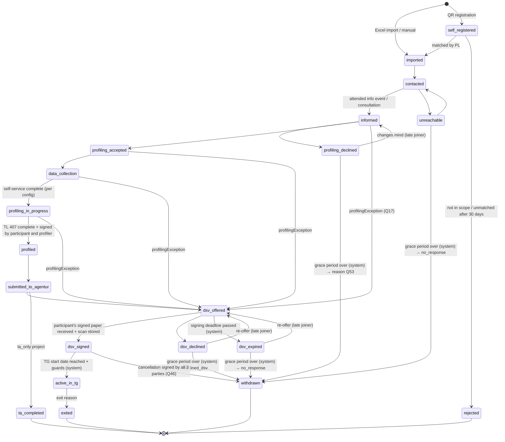

# Process & participant lifecycle

> Status: updated 2026-10-15 from the decisions log (`docs/decisions/`). Items marked
> *(provisional, Qnn)* rest on answers that are still `assumed` or `verify` in
> `open-questions.md`.

## Big picture

```
Customer (employer) ──► Transferprojekt (type: ta_only | ta_tg)
                          │
       ┌──────────────────┴───────────────────┐
  Phase 1: TA / pre-phase                Phase 2: TG / beE (max. 12 months per person)
  inform → self-service data → ASU →     employment in the beE, Transfer-KuG,
  profiling (TL 407) → DSV               coaching, qualification, applications, exit
```

- One **Person** has one **Participation** per project. In the MVP the same person is **not
  linked across projects** (Q30). Duplicate detection runs within a project only.
- The participation carries the lifecycle status. Modules (ASU, profiling, DSV, TG) attach to
  the participation as records with their own data.
- A project is **`ta_only`** (§110 measures only, no beE) or **`ta_tg`** (TA phase + beE).
  *(provisional, Q20)*

## Two Agenturen *(provisional, Q15)*

| Role | Belongs to | Determined by | Responsible for |
|---|---|---|---|
| **KuG-Agentur** | project | business location of the TG | Anzeige über Arbeitsausfall, Transfer-KuG, final KuG settlement |
| **Placement Agentur** | participation | participant's place of residence | Arbeitsuchendmeldung (Kug 200b), TL 407 submission, placement |

Participant steps resolve configuration from the placement Agentur's template, and project
steps from the KuG-Agentur's template (see regional-variation.md).

## Dates

- Legal and calendar dates (signing deadline, TG start/end, exit date, ASU due date, settlement
  dates) are stored as `date`, not timestamps. Timestamps (`timestamptz`) are for events
  (audit, uploads).
- **TG start and end are per participation**, defaulting from the project (Q18). TL 407 needs
  both ("voraussichtliche Verweildauer in der beE von/bis").
- **ASU due date** *(verify, Q1)*: `asuDueDate = max(endDate − 3 months, knowledgeDate + 3 days)`,
  where `endDate` is the end of the old employment and `knowledgeDate` is when the person
  learned of it. To subtract months, clamp to the last day of the target month
  (31.05. → 28./29.02., 31.12. → 30.09.). The later date applies.

## Project checklist (project-level BA steps) *(provisional, Q16, Q52)*

Not part of the participant state machine. Each item has a date, a document and a done-by:

- Consultation of the Betriebsparteien by the Agentur (before the Transfersozialplan)
- Anzeige über Arbeitsausfall to the KuG-Agentur
- `kugFinalSettlementDate` — final Transfer-KuG check by the Agentur (back office)
- `measure110SettlementDate` — settlement of the §110 grant, only if one exists (back office)

The settlement dates drive the evidence-set retention (data-protection.md). The admin dashboard
warns when a project ended more than 12 months ago without them.

## Lifecycle state machine (Participation)



Not drawn, to keep the diagram readable: **manual withdrawal** (`→ withdrawn`, reason chosen by
the PL) is allowed from every pre-TG state: `imported`, `contacted`, `unreachable`,
`informed`, `profiling_declined`, `profiling_accepted`, `data_collection`,
`profiling_in_progress`, `profiled`, `submitted_to_agentur`, `dsv_offered`, `dsv_declined`,
`dsv_expired`, and `dsv_signed` (only with the cancellation document). `self_registered` uses
`rejected` instead.

### States

| State | Terminal | Notes |
|---|---|---|
| `self_registered` | no | Registered via project QR (valid 14 days). PL matches manually. |
| `imported` … `submitted_to_agentur` | no | Phase 1 flow |
| `profiling_declined` | no | Can come back until the grace period ends *(provisional, Q53)* |
| `unreachable`, `dsv_declined`, `dsv_expired` | no | Can come back (late joiners) until the grace period ends (Q50) |
| `dsv_offered`, `dsv_signed` | no | |
| `active_in_tg` | no | Has dated sub-status periods (below) |
| `withdrawn` | **yes** | Pre-TG exit with a reason. Retention counts from here. |
| `rejected` | **yes** | Self-registration not in scope or unmatched. Deleted after 30 days. |
| `ta_completed` | **yes** | End of a `ta_only` participation |
| `exited` | **yes** | TG exit with a reason |

`profiling_accepted` means the person agreed to take part in profiling. It is **not** GDPR
consent: the legal basis for profiling is the legal obligation under §110/§111 SGB III (Q4).

### Rules

- Transitions are allowed **only along the arrows** (plus the manual withdrawal listed above).
  Implement this as a pure function in `packages/domain` (`canTransition(from, to, context)`),
  fully unit-tested.
- **Guards** depend on data and configuration (below). A PL can **override a guard** with a
  mandatory reason (audited, flagged for review). An override never creates an arrow that
  doesn't exist.
- Every transition writes an **audit event**: actor (`user`, `participant` or `system`),
  `onBehalfOf` (assisted mode), timestamp, from, to, reason. **System transitions** run in an
  idempotent nightly job with the `system` actor.
- **Late joiners** come back along the explicit return arrows (`unreachable → contacted`,
  `profiling_declined → informed`, `dsv_declined/dsv_expired → dsv_offered`) until the grace
  period ends. Terminal states are final.
- **Grace period:** 90 days after the project's signing deadline *(provisional, Q3)*. Then the
  system moves `dsv_declined`, `dsv_expired`, `unreachable` and `profiling_declined` to
  `withdrawn` with a derived reason.

### Guards

| Transition | Guard |
|---|---|
| `self_registered → imported` | PL matched the registration to an imported record |
| `data_collection → profiling_in_progress` | all required fields/documents of the resolved configuration present |
| `profiling_in_progress → profiled` | TL 407 generated, required fields valid (dates `TT.MM.JJJJ`), signed scan uploaded (participant + profiler) |
| `profiled → submitted_to_agentur` | submission recorded (channel, date) per the placement Agentur's config |
| `* → dsv_offered` (exception path) | `profilingException = true` + reason (Q17) |
| `dsv_offered → dsv_signed` | scan of the participant-signed DSV uploaded + who received it |
| `dsv_signed → active_in_tg` | TG start date reached; DSV **fully executed** (participant, customer, TG signatures recorded) (Q21); ASU registered (Kug 200b or other channel), required by §111(4) Nr. 4 SGB III; profiling `profiled`/`submitted_to_agentur` **or** `profilingException` |
| `dsv_signed → withdrawn` | cancellation document signed by all three parties uploaded; PL confirms; customer notification flag set *(verify, Q46)* |
| `active_in_tg → exited` | exit reason (+ placement details for placements) |

When a system transition's guard fails (e.g. TG start reached but the DSV is not fully
executed), the participation stays where it is and appears in the PL's "what's missing" list.

### Profiling exception *(Q17)*

If profiling wasn't possible before entry into the beE, the participation can enter the TG with
`profilingException = true` and a reason. The profiling record must then be completed within
**1 month of TG entry**, with reminders to the profiler and the PL. The profiling record keeps
its own status, independent of the lifecycle state.

### Exit and withdrawal reasons *(provisional, Q34)*

One enum with a `phase` attribute:

| Phase | Reasons |
|---|---|
| `pre_tg` (→ `withdrawn`) | `declined_dsv`, `no_response`, `placed_direct`, `self_employed`, `retirement`, `other_measure`, `deceased`, `other` |
| `tg` (→ `exited`) | `placed_permanent`, `placed_fixed_term`, `self_employed`, `retirement`, `apprenticeship_or_study`, `max_duration_reached`, `own_termination_without_job`, `terminated_by_tg`, `long_term_illness_reduced_earning_capacity`, `deceased`, `other` |

- `declined_dsv` and `no_response` exist only as reasons, never as states.
- Placements also record: `contractType` (full/part time), `fixedTermMonths`, `tempAgency`,
  `backToFormerGroup` (reported separately), `startDate`, optional new employer.
- **Integration rate** = placements (`placed_direct`, `placed_permanent`, `placed_fixed_term`,
  `self_employed`) ÷ all exits. Which reasons count is configurable.

### TG sub-status periods *(provisional, Q33, Q51)*

While `active_in_tg`, a participation has **dated periods** (from, to): `active`, `sick_paid`
(first 6 weeks), `sick_krankengeld` (no KuG), `parental_leave`, `qualification`,
`temp_employment_elsewhere` (fixed-term job with a right to return).

- These are payroll records: type and dates only. Never diagnoses, never AU scans (eAU: we only
  store "AU confirmed: yes, dates").
- Visibility: back office sees the type. PL and profiler see only "abwesend" with dates.
- Transfer-KuG is limited to 12 months per person: remind the PL before `max_duration_reached`.

## Phase 1 detail

| Step | Who | Output |
|---|---|---|
| Project setup | PL | project type, KuG-Agentur, dates (signing deadline, default TG start/end), modules, regional templates |
| Import | PL | participations in `imported`; import report with row errors/duplicates |
| Registration QR | PL → participants | `self_registered` participations, matched manually by the PL |
| Info events & appointments | PL/Berater, participants self-book | attendance → `informed` |
| Consents | participant | consent records per purpose (portal contact, Kug 200b profile access) |
| Self-service data collection | participant (or staff in assisted mode) | personal data, CV, documents |
| Arbeitsuchendmeldung | participant / TG | ASU record: channel, `registeredOn`, placement Agentur, Kug 200b scan if via TG; batch submission per Agentur |
| Profiling | profiler + participant | profiling record, TL 407 (incl. "Anlage" for overflow), signatures |
| Submission to Agentur | assigned PL | submission status and channel per participant |
| DSV | PL / back office | generated DSV, paper signatures of all three parties, scan, original location |

## Phase 2 detail (TG module)

| Area | Content |
|---|---|
| Participant file | phase 1 data + beE employment data |
| Coaching | appointments, structured notes, goals, agreed tasks |
| Qualification | activities: course, provider, cost, `fundingSource`, `approvalStatus` (customer budget owner approves in writing), certificate (Q23) |
| Applications | applications, interviews, trial work (Probearbeit), offers |
| Sub-status periods | see above; input for payroll/KuG export |
| Exit | reason, date, placement details → statistics |

§110 measures in `ta_only` projects (profiling, application training, career guidance, short
qualification) are activity records with date, duration and attendance (Q20).

## Roles (summary — access rules in data-protection.md)

Admin, Regional admin (region = Niederlassung), PL, Berater/Profiler, Back office,
Participant. The customer is **not a user in the MVP**: it receives a monthly export from the
PL (Q47). Access is role × project, plus assignment for profilers.
