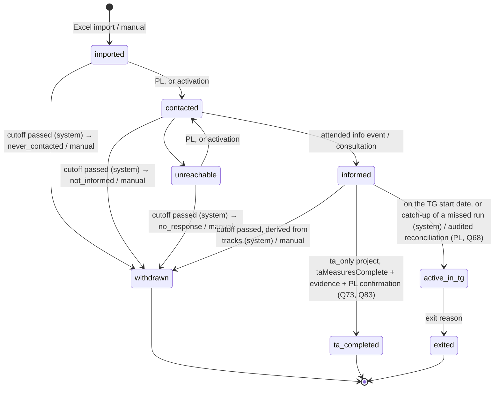
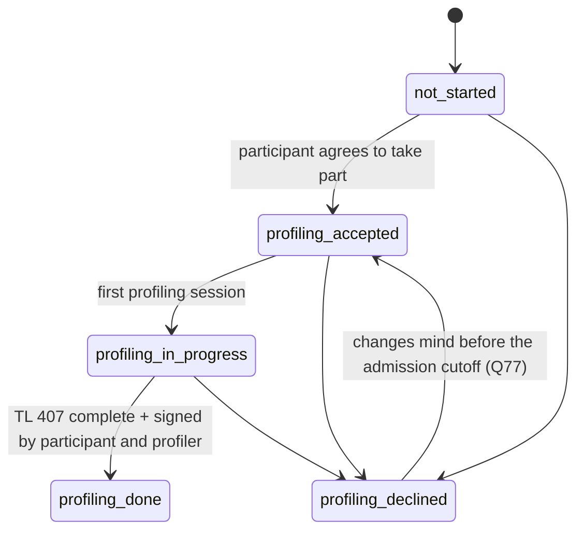
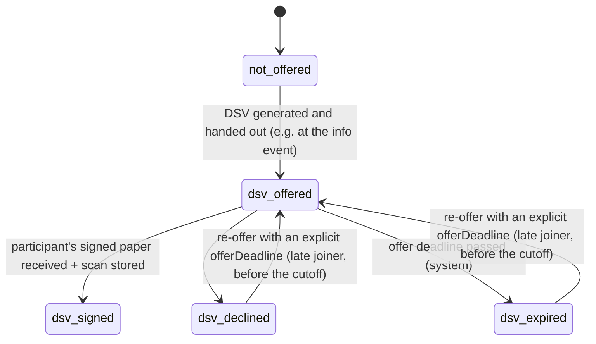

# Process & participant lifecycle

> Status: updated 2026-10-15 from the decisions log (`docs/decisions/`), including the
> two-track model from the PR #1 review (round 4), and 2026-10-16 from round 7 (deadlines from
> the contract, final admission cutoff, no overrides of documentary guards, employment vs.
> Transfer-KuG eligibility), and from round 8 (entry waves, catch-up of missed runs, approval of
> profiling exceptions, three Transfer-KuG outcomes, `taMeasuresComplete`) and round 9 (cutoff
> for participations without a wave, snapshot rule for TG entry) and round 10 (waves vs. beE
> units, profiling exception requests, end-reason corrections), and 2026-10-21 with Slice 3 PR 3d
> activation issuance, handover, notice evidence and terminal revocation. Items marked
> *(provisional, Qnn)* rest on
> answers that are still `assumed` or `verify` in `open-questions.md`.

## Big picture

```
Customer (employer) ──► Transferprojekt (type: ta_only | ta_tg)
                          │
       ┌──────────────────┴───────────────────────────┐
  Phase 1: TA / pre-phase                         Phase 2: TG / beE (max. 12 months per person)
  contact → inform → in parallel:                 employment in the beE, Transfer-KuG,
     profiling track (TL 407)                     coaching, qualification, applications, exit
     DSV track (paper DSV, 3 signatures)
     Arbeitsuchendmeldung (Kug 200b)
```

- One **Person** has one **Participation** per project. In the MVP the same person is **not
  linked across projects** (Q30). Duplicate detection runs within a project only.
- A project is **`ta_only`** (§110 measures only, no beE, no DSV track) or **`ta_tg`** (TA phase
  + beE). *(provisional, Q20)*

## Two Agenturen *(provisional, Q15)*

| Role | Belongs to | Determined by | Responsible for |
|---|---|---|---|
| **Project Agentur** (`ta_tg`: the **KuG-Agentur**) | project | set at project setup (`ta_tg`: business location of the TG) | `ta_tg`: Anzeige über Arbeitsausfall, Transfer-KuG, final KuG settlement; `ta_only`: the §110 measure and its funding administration (Q90) |
| **Placement Agentur** | participation | participant's place of residence, chosen by the PL or back office (Q139) | Arbeitsuchendmeldung (Kug 200b), TL 407 submission, placement |

Participant steps resolve configuration from the placement Agentur's template, and project
steps from the Project Agentur's template (see regional-variation.md). Without a Project-Agentur
template a project of either type can't be activated (Q76, Q90).

The placement Agentur *(assumed, Q139)* is a key on the participation, set by the PL or back
office of the project while the participation isn't terminal (also in a draft project), from
the catalog or a free key; it isn't a lifecycle status and needs no transition. Choosing a
catalog Agentur the project hasn't pinned pins its latest template version in the same step;
without a template the participation can still be contacted, collect data and be profiled, but
its Agentur submission stays blocked until the Agentur's settings are known (Q76). There is no
mapping from the postcode: a later address change only shows "Vermittlungs-Agentur prüfen".
Every change is audited (`placement_agentur_set`). Details in regional-variation.md, "Placement
Agentur".

## Dates

- Legal and calendar dates (signing deadline, TG start/end, exit date, ASU due date, settlement
  dates) are stored as `date`, not timestamps. Timestamps (`timestamptz`) are for events
  (audit, uploads).
- **The project carries no contractual dates** (Slice 2): they live on its entry waves. A
  project is `draft` (setup, import, creation; no post-creation lifecycle transition) until it is
  activated once its blockers are gone, then `active` (Q98).
- **Draft and active**: a draft project takes project data, the Project
  Agentur, pins, overrides, waves, import, creation along the creation edge, wave assignment,
  person data and individual dates, but **no post-creation lifecycle transition**, manual or
  system: the status service refuses it (`project_not_active`), the database function refuses it
  too, and the nightly job plans nothing for a draft project. The PL activates the project
  (`POST /projects/{id}/activation`) once `projectActivationBlockers` is empty: a pinned
  Project-Agentur template (Q76, Q90) and, in `ta_tg`, a wave with a `latestEntryDate` (Q77).
  Agentur-submission blockers never block activation; they come back as warnings with their
  Agentur and step (Q91, Q92). Activation is one-way; the type and the Project Agentur are fixed
  from then on (Q98).
- **Editing a project** (Q98): name and customer change any time; the type only while the project
  is `draft` and has neither participations nor waves (`project_not_draft`,
  `project_has_participations`, `project_has_waves`).
- **TG start and end are per participation**, defaulting from the participation's entry wave (Q18, Q79). TL 407 needs
  both ("voraussichtliche Verweildauer in der beE von/bis").
- **ASU due date** *(verify, Q1; corrected 2026-10-24, Q178)*: the two branches of §38(1)
  SGB III, where `endDate` is the end of the old employment and `knowledgeDate` is when the person
  learned of it. The reference date is `endDate − 3 months` (to subtract months, clamp to the last
  day of the target month: 31.05. → 28./29.02., 31.12. → 30.09.). Knowledge on or before the
  reference date → due on the reference date; knowledge after it (less than three months before
  the end) → due 3 days after the knowledge. The earlier unconditional `max(endDate − 3 months,
  knowledgeDate + 3 days)` is wrong (end 30.06.2027, knowledge 29.03.2027: due 30.03.2027, not
  01.04.2027); `asuDueDate` (`packages/domain/src/dates.ts`) follows the two branches since Slice 6
  (PR 6-4a) and names the branch. Without a knowledge date the due date is unknown: the reference
  date is only an orientation, never an overdue finding. Calendar, boundary, weekend/holiday and
  unusual cases stay under Q1.
- **The knowledge date** (`knowledgeDate`, `participant_details`, `personnel_file`, confidential) is
  the individual's fact: an optional import target and the PL's audited correction on the tab
  "Arbeitsuche" (`set_knowledge_date`, `knowledge_date_set` without the date; not after today;
  `409 stale_value` against the date read), never inherited from a wave or a project (Q201).
- **Signing and entry deadlines come from the Sozialplan / DSV / entry wave** (Q69), never from
  an Agentur template and never invented by the system.
- **Entry waves** (Q79): every `ta_tg` project has **one or more entry waves**, each with a
  name/code, `signingDeadline`, default TG start and end, and **`latestEntryDate`**. Each
  participation belongs to **exactly one wave before its DSV is offered**; individual
  contractual dates may override the wave defaults, with audit. An active `ta_tg` project needs
  at least one wave with a `latestEntryDate`, otherwise it stays draft (Q77). The project's final
  entry date (the latest wave cutoff) is derived, for project-level reporting only.
  A wave is a **timing cohort**, not a beE and not a Transfer-KuG bucket (round 10): one beE may
  hold several waves, or a later wave gets its own beE with its own term; a later `bee_unit` /
  Transfer-KuG case is a separate entity that waves reference. `ta_only` projects have no waves
  (their cohorts are measure groups).
  - `signingDeadline` (wave): the deadline of the first DSV offer. A **re-offer** needs an
    explicit participation-level **`offerDeadline`**, no later than the wave's `latestEntryDate`
    and the planned TG start. If no contractual rule is recorded, the PL enters the deadline.
  - **`latestEntryDate`** (wave): the last possible entry into the beE, inclusive. The **final
    admission cutoff** starts the following Berlin calendar day (Q77). It **replaces the former
    "signing deadline + 90 days" grace period**.
  - Deadlines are **inclusive**: expiry happens the following day.
  - **Creating and editing waves** (Q101): only the
    PL, through `create_entry_wave` / `update_entry_wave` under the exclusive project lock, each
    with one audit event (changed keys and old/new dates, never the name). The `code` matches
    `^[A-Za-z0-9_-]{1,20}$` and is unique in the project; the `name` is 1–100 characters
    (trimmed, no control characters). The dates are ordered
    `signingDeadline ≤ defaultTgStart ≤ latestEntryDate`, `signingDeadline ≤ latestEntryDate`,
    `defaultTgStart ≤ defaultTgEnd`, and the default period is at most twelve months
    (`defaultTgEnd ≤ addMonths(defaultTgStart, 12) − 1 day`, Q102). Once in use: a
    `latestEntryDate` is never set before today and never changes once its cutoff has passed; the
    `signingDeadline` doesn't change while first offers of the wave are open; a default TG start
    that has been reached (`≤ today`) doesn't change, and a new one isn't before today while
    participations rely on it; dates are cleared only while the wave has no participation, never
    the last `latestEntryDate` of an active project. Waves aren't deleted.
  - **Assigning a wave** (`ta_tg` only, PL): while `imported`, `contacted`, `unreachable` or
    `informed` and the DSV is `not_offered`. A participation with its own `tgStart` or `tgEnd`
    keeps its wave (`individual_dates_set`, in the domain and the database function), so a wave
    change never silently changes individual contractual dates. A wave change creates no DSV
    amendment and no BA reporting task.
  - **Bulk assignment** (Slice 5): the PL assigns one wave to 1–500 participations of the work
    list, all or nothing, under the exclusive project lock: every participation passes the same
    checks first, then each gets `assign_entry_wave` (one `entry_wave_assigned` each). Any refusal
    assigns none and names every refused row's index and code; a participation already in the
    wave stays as it is (`unchanged`).

## Project checklist (project-level BA steps) *(provisional, Q16, Q52)*

Not part of the participant lifecycle. Each item has a date, a document and a done-by:

- Consultation of the Betriebsparteien by the Agentur (before the Transfersozialplan)
- Anzeige über Arbeitsausfall to the KuG-Agentur
- `kugFinalSettlementDate` — final Transfer-KuG check by the Agentur (back office)
- `measure110SettlementDate` — settlement of the §110 grant, only if one exists (back office)

The settlement dates drive the evidence-set retention (data-protection.md). The admin dashboard
warns when a project ended more than 12 months ago without them.

## Lifecycle model: main status + two tracks + ASU record

In practice the DSV is handed out at the info event with a signing deadline, **in parallel
with profiling** (round 4). So a participation has:

| Part | Field | Values |
|---|---|---|
| **Main status** | `status` | `imported`, `contacted`, `unreachable`, `informed`, `active_in_tg`; terminal: `withdrawn`, `ta_completed`, `exited` |
| **Profiling track** | `profilingStatus` | `not_started`, `profiling_accepted`, `profiling_in_progress`, `profiling_done`, `profiling_declined` |
| **DSV track** | `dsvStatus` | `not_offered`, `dsv_offered`, `dsv_signed`, `dsv_declined`, `dsv_expired` (only in `ta_tg` projects) |
| **ASU record** | `asu` | not a state machine: the route (`asuChannel`) and a registration with its channel, `registeredOn`, proof and the instant of the complete fact; optional `confirmedOn` (Slice 6, PR 6-5a) |

- The tracks start when the main status reaches `informed`. Before that they stay at
  `not_started` / `not_offered`. **Track activity** (domain and database function): the tracks
  move only while the main status is `informed`, the DSV track only in `ta_tg`; while
  `active_in_tg` with an approved profiling exception, only forward profiling moves and a
  refusal (`→ profiling_declined`); otherwise, and after any terminal status, a track change is
  refused (`track_inactive`).
- Each track has its own transition function in `packages/domain`
  (`canTransition(track, from, to, context)`), and every change of any track goes through the
  same audited status function (see Rules). Every edge with its actors and guards, and the
  operations without a status change, are listed in the generated
  [lifecycle transitions table](generated/lifecycle-transitions.md).
- The UI may show **one derived overall status** (e.g. "DSV unterschrieben, Profiling offen"),
  computed from the main status and both tracks. It is never stored.
- **Lifecycle flags are derived, never stored** (`lifecycleFlags`, `projectFlags` in the
  planner; vocabulary `LifecycleFlag` / `ProjectFlag` in `packages/domain/src/lifecycle/enums.ts`).
  They inform or escalate, never change a status: `tg_start_missed` (`informed`, effective TG
  start passed), `cutoff_warning`, `cutoff_final_reminder`, the cutoff cases for the PL
  (`conflict_dsv_signed_profiling_declined`, `dsv_never_offered`,
  `informed_without_wave_at_cutoff`), and the compliance flags, only while `active_in_tg`:
  `profiling_declined_after_entry`, `profiling_exception_deadline_missed`. Project flag:
  `latest_entry_date_missing` (a `ta_tg` project without waves or with a wave lacking one).
- **Deadline warnings** (Slice 5; Q151; `deadlinesOf`, `packages/domain/src/worklist/`): the
  work list and the dashboard list every applicable deadline of a participation as
  `{ kind, date, state }`. They inform, never guard. `upcoming` from 14 calendar days before the
  date up to the date itself, `overdue` from the day after (deadlines are inclusive, Q69); a date
  further away isn't listed. The kinds, in their tie order:

  | Kind | Applies while | Date | Replaces the flags |
  |---|---|---|---|
  | `offer_deadline` | `dsv_offered` | the effective offer deadline | — |
  | `tg_start` | `informed` | the effective TG start | `tg_start_missed` |
  | `asu_due` | `ta_tg`, before `active_in_tg`, not terminal, no registration with proof, a knowledge date and the end of the old employment known (Slice 6) | the statutory ASU due date (Dates) | — |
  | `latest_entry_cutoff` | the cutoff would withdraw or flag it, as it will be at the cutoff (`latestEntryCutoff`, the warning's condition) | the applicable latest entry date (the wave's, else the project's final one, Q84) | `cutoff_warning`, `cutoff_final_reminder` |
  | `privacy_notice` | the Article 14 notice isn't provided (Q124; any status, *assumed*, Q160) | its due date | — |
  | `profiling_exception` | `active_in_tg` under an approved exception, profiling neither done nor declined | entry + 1 month (Q74) | `profiling_exception_deadline_missed` |

  `latest_entry_cutoff` carries `final: true` from 3 days before the cutoff while it is upcoming
  (Q78). A flag a deadline replaces is never listed beside it, so a cutoff counts once; the flags
  that stay flags are `conflict_dsv_signed_profiling_declined`, `dsv_never_offered`,
  `informed_without_wave_at_cutoff` and `profiling_declined_after_entry`. A row shows its most
  urgent deadline: the oldest overdue one, else the earliest upcoming one, a tie by kind order.
  Without a knowledge date the row carries the item `knowledge_date_missing` with the reference
  date as a labelled orientation ("Orientierung … – Kenntnisdatum klären"), shown when no dated
  deadline is due and never overdue; no automatic reminder (Q1, Q152).
- **Participant actions** (Slice 5; Q151; `participantActions`): what the participant still has
  to do in the portal, from the wizard's steps (`data_collection`, `profiling`) of the
  participation's own resolved chain: one action per missing field on a wizard page (custom fields
  included) that the viewer may know about (the "Selbstauskunft" tab's rule), then one per
  document type of the participant's own types: `missing` when a rule needs a live document and
  there is none, `rejected` when every live document of the type is rejected (a required type
  never counts as both). An upload waiting for its review asks nothing of the participant. A
  terminal participation has no actions (*assumed*, Q160). Codes only, never a value.
- **Appointment items** (Slice 5b; Q167, accepted; readings Q175; `appointmentItems`,
  `packages/domain/src/worklist/appointments.ts`): beside the deadline warnings each row has
  `appointments: { next, items }`. `next` is the earliest live booking of a scheduled appointment
  that hasn't started (kind and start). The items, each `{ kind, appointmentId, appointmentKind,
  startsAt }`, in this urgency order, then by start (the row shows the first, else `next`):
  - `attendance_missing`: a live booking whose appointment's Berlin end date has passed (from the
    next day), attendance unrecorded; it stays after the participation closed (the PL's
    closed-case flow, "Attendance and `informed`");
  - `missed`: a live booking recorded `absent` (not a basis of `informed`: its absence is the
    conflict's) without an explicit resolution and without a **live follow-up**. For an info event
    the follow-up is any later info-event booking of the participation (the same briefing purpose,
    matched automatically); for a consultation only a consultation staff booked as its follow-up
    (`followUpOf`; an unrelated consultation clears nothing). A follow-up counts while it is live
    (upcoming, unrecorded or attended): cancelled, the item is back; recorded `absent`, the
    follow-up is the chain's one missed item. "Keine weitere Nachverfolgung" by the PL or the
    assigned consultant, with a closed reason (`participant_declined`,
    `information_delivered_otherwise`, `no_longer_needed`), ends the chain
    (`resolve_missed_appointment`, audited `missed_appointment_resolved`; once: `already_resolved`;
    only while missed: `not_missed`; not for a closed participation: `participation_closed`).
    "Folgetermin buchen" books another appointment of the kind; a consultation is linked
    (`book_appointment` with `follow_up_of`: a missed consultation of the same participation,
    `follow_up_not_found`, `follow_up_kind_mismatch`, `follow_up_not_missed`);
  - `notice_undelivered`: an organizer's notice without its follow-up (data-protection.md,
    messages about appointments);
  - `needs_resolution`: a live future consultation booking whose host may no longer list the
    participation, for the PL only (data-protection.md, appointments);
  - `attendance_conflict`: a basis corrected to `absent`, open or escalated, also after the close.

  They inform staff: never a guard, a participant action or a reminder. A terminal participation
  keeps `attendance_missing` and an unresolved `attendance_conflict`, nothing else. The filter
  `appointment` takes `upcoming` (a `next`), `overdue` (`attendance_missing` ∪ `missed`),
  `to_resolve` (`notice_undelivered` ∪ `needs_resolution` ∪ `attendance_conflict`) or one kind; the
  dashboard's tiles "Termine überfällig" and "Termine zu klären" and its group "Termine" count the
  distinct participations each value matches in the same snapshot.

### Main status



**Manual withdrawal** (`→ withdrawn`, reason chosen by the PL) is allowed from `imported`,
`contacted`, `unreachable` and `informed`. If `dsvStatus = dsv_signed`, it additionally needs
the cancellation document (see DSV track).

**Activation-code issuance (as built in Slice 3, PR 3d):** the project's PL or back office may
issue a letter, event sheet or in-person code while the project is active and the participation is
non-terminal. Before `informed`, issuance is refused after the participation's cutoff. Letters need
the imported postal address and birth date. Event sheets are not usable until an audited handover
after a photo-ID check; in-person codes record the same check before being sent. Reissue is explicit
and revokes the open code atomically. This step does not change lifecycle status.

**Account activation** (Q116, Q121, [round 36](../decisions/2026-10-20-answers-round-36.md),
as built in Slice 3 PR 3e): a participant's first activation moves `imported` or `unreachable` to
`contacted` in the same transaction, along the edges of kind `activation` (actor `participant`, the
only edges a participant takes, each with `before_cutoff`). Before `informed` it needs the
participation's cutoff not to have passed: checked when the code is accepted and again with
database time at completion (`before_cutoff`). In `contacted`, `informed` or `active_in_tg` it
changes no status. Only `complete_activation` takes these edges: it calls the internal
`apply_status_change`, which holds the status body; the granted `change_participation_status`
keeps its signature and refuses a participant actor (`actor_not_allowed`). An activated account
gets no new activation code (`already_activated`; a recovery code comes with PR 3f).

A terminal status runs in the status transaction: moving to `withdrawn`, `ta_completed` or
`exited` revokes every open activation code as `participation_closed`, ends the participant's
sessions (`participation_closed`) and cancels the live bookings of appointments that haven't
started (`participation_closed`, audited by the system; see "Appointments").

There is no self-registration: `self_registered` and `rejected` (its only path) left the
lifecycle core in Slice 3 ([round 35](../decisions/2026-10-20-answers-round-35.md)).

### Profiling track



- `profiling_accepted` means the person agreed to take part. It is **not** GDPR consent: the
  legal basis is §110/§111 SGB III (Q4). The participant can still refuse, but then loses
  Transfer-KuG eligibility. The signature on TL 407 page 2 is a declaration on the form, not
  our consent record.
- Self-service data collection runs alongside: its completeness is derived per participation
  from its own resolved chain (the base TL 407 rules of the `profiling` step plus its placement
  Agentur's and the override's, `regional-variation.md`, "Self-service wizard"), shown as codes in
  "what's missing", and pre-fills TL 407. It is not a state: there is no "submitted"; each page is
  saved on "Weiter" and the participant may leave one incomplete.
- The TL 407 **submission to the Agentur** is tracked on the document (date, channel). It is a
  **"what's missing" item, not a TG entry guard** (Q54): §111(4) Nr. 4 requires taking part in
  profiling before the transfer, not submitting the form.
  - Not submitted by the TG start date → warning on the PL dashboard.
  - Still not submitted 14 days after TG start → escalation to the PL and the regional admin
    (the regional admin sees project, responsible PL, overdue count per type and days overdue
    for the oldest item; no participant names — Q57).
  - With the profiling exception, submission follows once profiling is caught up within the
    1-month deadline.
  - Also checked against the placement Agentur's `leadTimeDays`.
- **After TG entry with the profiling exception** *(verify, Q74)*: forward profiling
  transitions continue, and a later refusal (`→ profiling_declined`) can be recorded, because
  the system must not hide what happened. A refusal or a missed one-month deadline is an
  **immediate compliance escalation**; it doesn't end the employment automatically. See
  "Employment vs. Transfer-KuG eligibility".
- **Profiling exception requests** (`ta_tg` only; Q80, Q81, round 10): the PL requests one while
  `informed`, profiling still open and a future TG start applies, with a reason code and
  evidence. A different user (regional operations manager) approves or rejects it under the
  same conditions; only an approval counts, from its date. Each request is its own record
  (round 16): a rejected, revoked or superseded request is never reopened or overwritten; its
  reason and evidence (one immutable evidence record, by id and canonical fingerprint) never
  change. A new request needs changed evidence (a different fingerprint, not just another
  record) and its own approval. A pending request is **superseded** automatically when
  profiling finishes, the participation closes or the project becomes `ta_only`; the PL
  **revokes** one that still applies. A passed start leaves it pending for a new start date,
  but it can never authorise entry for the missed date. All closures are audited.

### The profiling record *(accepted, Q192, Q193; as built in Slice 6, PR 6-2; readings Q198)*

The staff app's tab "Profiling" (data-protection.md, the profiling record, for who sees what):
- **Track actions** (`POST /participations/{id}/profiling-status`, Q60): the PL and the assigned
  consultant take one step along an edge of the
  [transitions table](generated/lifecycle-transitions.md) with the participation's
  `statusVersion` (`409 stale_status`), through the status service and the status function, so
  every step is audited `status_changed` and checked by `canTransition` with track activity as
  built (also forward and a refusal while `active_in_tg` under an approved exception, Q74). The
  buttons: "Teilnahme zugestimmt", "Profiling begonnen", "Abgelehnt" (after a confirmation that
  names the loss of Transfer-KuG), "Erneut zugestimmt" (before the cutoff, Q77); each step comes
  with its refusal (`forbidden`, `project_not_active`, `track_inactive`, the guard).
  "Profiling abschließen" (`profiling_done`, Slice 6, PR 6-3b) needs `tl407_signed` and
  `profilingDoneOn` (Q191): an accepted signed TL 407 that is neither quarantined nor invalidated
  (data-protection.md, signed scans); `profilingDoneOn` is by default its later actual signature
  date, never before it (`effective_date_before_signature`) and never in the future; the recording
  instant stays apart. The status function holds that scan `FOR SHARE` until the commit. Back
  office takes no profiling step.
- **The TL 407 facts** (`dbGuardFacts`, the database instant of each complete fact; the snapshot
  rule under "TG entry guard"): `tl407Signed` is valid on the earliest later signature date of the
  usable scans (accepted, not quarantined, not invalidated) and recorded at that scan's acceptance
  (after a quarantine, at its lift); `profilingDone` exists only while a usable scan signed by
  `profilingDoneOn` supports that date (Q200): valid on `profilingDoneOn`, recorded at the later of
  the status change and the earliest supporting scan. Without one (the supporting paper was
  quarantined and only later-signed paper remains) the fact is withheld: the status and its date
  stay as recorded for a controlled resolution, are never moved automatically, and the tab says the
  completion isn't supported. A TL 407 accepted after the TG start's
  scheduled run therefore supports only a reconciliation, never the scheduled entry or its catch-up;
  a quarantined scan supplies no fact to a later evaluation, and no status is reversed by it.
  `asuRegisteredWithProof` (Slice 6, PR 6-4a; `asuRegisteredSince`) is valid on the actual
  registration date and recorded at the later of the registration, the link of its accepted proof
  and a lifted quarantine of the proving document: a proof accepted yesterday and linked today is
  recorded today. Without a proof, or with a quarantined or invalidated proving document, there is
  none. The DSV and exception-evidence facts stay fail closed until their PRs, so nobody enters the
  TG on real facts yet; the seed overlays its synthetic facts.
- **Sessions** (Q193): date and `von`/`bis` (`hh:mm`), written whole by the assigned consultant
  with the record's revision (`409 stale_revision`): `bis` after `von` (equal refused), no date
  after today in Berlin, no two of one day overlapping (touching ends are fine), at most 50. Each
  session added, changed or removed is audited `profiling_session_changed` (its id and date). The
  PL reads them. Recording a session doesn't move the track, and a booked consultation is never a
  session by itself. They are evidence-set data (`participation_record`, Q88).
- **The pending declarations to the BA** (ba-forms.md, declarations): the Jobbörse choice and the
  BA contact declaration on the record, `null` while undecided, written by the assigned consultant
  with the same revision, audited `profiling_declarations_recorded` with the changed keys.
- **Section C, p. 7 and the unemployment period**: the profiler's, encrypted and each field
  audited (data-protection.md, the profiling record); the health line keeps its rating only.
  Gesamteinschätzung and weiteres Vorgehen keep their paragraph breaks into the TL 407; the line
  texts are single-line. The assessment and the unemployment period each have their own revision
  (`409 stale_revision`, also when clearing the period). A period whose "seit" is after its "bis"
  is stored with a warning shown when saving, not refused (a plausibility check, not a BA rule).
- **Concurrent editing** (ADR-0010, the profiling record): the tab reads each section's values
  with the revision they belong to; a save keeps its own returned revision with what it saved.
  The sessions and the declarations share the record's revision: saving one keeps the other's
  unsaved input and moves its revision on while its stored value is unchanged; if another tab
  changed that value meanwhile, the section says so and keeps the input until "Neu laden", and a
  save from the stale input is refused (`409`), never applied.
- **The highest school qualification** (Q196): the participant marks one education row in the
  wizard, the profiler confirms or corrects it with them in assisted mode; the TL 407 lists it
  first (ba-forms.md, row order). Never inferred. Before TL 407 generation (Slice 6, the TL 407),
  an explicit reviewed "no school qualification" answer is valid and "not yet clarified" is
  incomplete; no row is fabricated, and a review holds only for the source values it reviewed.
- A terminal participation takes no profiling writes (`participation_closed`); the tab shows it
  read-only and says why. Corrections after the end go through the controlled correction route,
  not ordinary editing.

### DSV track (only `ta_tg`)



- `dsv_signed` = the **participant** has signed. The DSV document also tracks
  `customerSignedOn` and `tgSignedOn`. **`dsvFullyExecuted`** is derived: all three dates are
  set (Q21).
- PLs get a list of DSVs **signed by the participant but not yet fully executed**, because this
  is where things typically get stuck.
- Original tracking per document: `originalLocation`, `receivedOn`, `sentToCustomerOn`.
- **Wave and offer deadline** (Q69, Q79): the DSV can only be offered once the participation
  is assigned to an entry wave. The first offer uses the wave's `signingDeadline`; a re-offer
  needs its own `offerDeadline` (≥ today, ≤ the wave's `latestEntryDate`, ≤ planned TG start; see
  Guards). If neither
  exists, the offer can't be recorded until the PL enters one. `dsv_expired` happens the day
  after.
- **Withdrawal after `dsv_signed`** *(verify, Q46)*: before TG start, main status → `withdrawn`
  only with an uploaded cancellation document signed by all three parties. The PL confirms, and
  a customer notification flag is set. After TG start it is a normal TG exit.

### Arbeitsuchendmeldung (ASU)

Legally the registration counts, not the form: §38 SGB III allows registration online, in
person or by phone. Kug 200b is the usual channel in transfer projects, not the only valid one
(Q55).

- The ASU record stores `channel` (`kug_200b`, `online_self`, `in_person`), `registeredOn`, and
  **proof**: the submitted Kug 200b, a BA confirmation, or the BA-Kundennummer noted by the PL.
- **Registered** = a registration with proof, **regardless of channel**. This is what the TG
  entry guard checks.
- For `kug_200b`: `registeredOn` is the submission date to the Agentur, with the submission
  channel. Agentur confirmation (`confirmedOn`) is optional. No confirmation 14 days after
  submission → warning for the PL to follow up.
- If someone registered themselves, **still offer Kug 200b**, because it carries the consent
  that gives the TG access to the BA profile. This is a "what's missing" item, not a guard.
  Without it, the profile-access consent record simply stays empty.
- The **Kug 200b offer and its outcome are recorded separately** from the ASU proof (round 14):
  the participant may decline it, and a declined offer is an outcome, never a "missing signed
  scan". The RV-Nummer and the accepted signed scan are required only when ASU uses
  `kug_200b`; after `online_self` or `in_person` the ASU proof is enough for entry.
- An accepted ASU proof stands for the proof of **any valid channel**, including a structured PL
  attestation of the BA-Kundennummer; it never requires an uploaded file. A Kug 200b scan is
  accepted only when the review checked both declarations (fields 16 and 17) and the
  handwritten signature.
- The ASU completeness rules apply in `ta_tg` projects only (Q89); `ta_only` participants
  register themselves.
- `asuDueDate` (see Dates) gives the deadline `asu_due`; no automatic reminder until Q1 is
  confirmed (Q152).
- **As built (Slice 6, PR 6-4a; Q186, Q201):** the PL or the assigned consultant sets the
  route with its version (`set_asu_route`, `asu_route_set`), the placement Agentur's
  `defaultChannel` preselected, never a blocker; it is fixed once a registration is recorded (an
  entry error is corrected through an approved correction, PR 6-8). On `online_self` /
  `in_person` the PL or the assigned consultant records the actual date (`record_asu_registration`,
  not after today) with the route version they reviewed (a route changed since is
  `409 stale_revision`, never frozen unseen); its proof is either the PL's **attestation** given with it (the BA-Kundennummer,
  write-only and encrypted, with where it was verified: `ba_document_inspected`,
  `ba_online_account_inspected`, `ba_confirmed_by_phone`) or an accepted BA confirmation
  (`asu_proof`) the assigned consultant links afterwards (`link_asu_proof`, `asu_proof_linked`). A
  registration without its proof gives no fact. On `kug_200b` the batch's submission records the
  registration (Kug 200b batches below). One registration per participation (`asu_registered`).
- **Completeness** (regional-variation.md, the base rules): the engine's state for `asu_proof`
  comes from the record: accepted once a registration with proof exists, on any route, without a
  file; else the live BA confirmations', an accepted but unlinked one still awaiting its link. The
  Kug 200b rules apply on the route `kug_200b` only (`asuChannel`, the rule `when`).

#### The Kug 200b offer *(accepted, Q179, Q184, Q185; as built in Slice 6, PR 6-4b; readings Q202)*

`ta_tg` only (Q89). The offer is separate from the ASU proof; neither its outcome nor a withdrawal
touches a registration.

- **Offered** once a Kug 200b was generated (the PL or the assigned consultant on the tab
  "Arbeitsuche", the PL also for 1–100 participations from the work list, all or nothing) or a
  signed external paper was received. Generation prints fields 1–12; 13–19, the declarations 16
  and 17 and the signature are the participant's hand. Before printing, a **handwriting and
  clarification checklist** names every blank `*` field (`required_blank`) and every text too
  long for its box (`text_not_fitting`), stored with the generation (ba-forms.md, Kug 200b as
  built).
- **Outcome `signed`:** an accepted, usable signed scan (generated or external paper). The review
  needs the date written in field 19 (not after today; for a generated scan not before its
  generation) and three confirmations made on the actual paper: **16 and 17 ticked, the mandatory
  information completed, signed**; nothing is preselected. It records the signed declarations 16
  and 17 and declaration 17 as written as one consent record (purpose `kug200b_profile_access`,
  source `paper_form`, given on the field-19 date, the scan; data-protection.md, signed
  declarations). One record is in force, by the dates and never the order of acceptance: an
  accepted paper is in force only if signed after every withdrawal received and not before a
  record in force whose paper is usable, and then supersedes the earlier (`consent_ended`,
  `superseded`); an older paper is kept as history, its record ended `superseded` at once, so a
  renewed declaration needs a later paper. A quarantined, deleted or invalidated paper's record
  isn't shown as in force; its withdrawals and their BA notice stay.
- **Outcome `declined`:** recorded with its date by the PL or the assigned consultant, once, while
  nothing is signed and the route isn't `kug_200b` (`asu_route_kug200b`: the route changes first,
  so a declined offer is never a missing scan). A later signed paper still makes the outcome
  `signed`.
- **A withdrawal** of declaration 17 that reaches the TG in writing is recorded by the same roles
  with the date received (not after today, not before the date on the paper), also after the
  participation's end: the record ends `revoked` (`consent_ended`), and the item
  `kug200b_withdrawal_ba_notice` stays open until "BA informiert am" is recorded (not before the
  receipt). The platform records that the BA was told, never that its access was disabled; what a
  withdrawal effects stays with the DPO/legal check (Q185 `verify`).
- **Work-list items** (`caseItems`, beside the deadlines): `kug200b_offer_open` with the offer's
  date while an open participation's offer has no outcome and its route isn't `kug_200b` (there the
  step's rule `base-kug200b-signed-scan` names the missing scan); never a guard.
  `kug200b_withdrawal_ba_notice` with the earliest unnotified withdrawal's date of receipt, also
  after the end. Filters and counts follow with 6-5b.

#### Kug 200b batches *(accepted, Q45, Q91, Q187, Q203; as built in Slice 6, PRs 6-5a-1 and 6-5a-2; readings Q205)*

`ta_tg` only. The PL alone builds and sends them (the project tab "Agentur"); back office never
opens a signed Kug 200b (Q49).

- **Per placement Agentur:** its resolved `batchSubmissionChannel` (unset: "Einstellungen fehlen",
  the `asu_registration` step blocker refuses a batch, `batch_settings_missing`, Q91) and the
  **artifact**: the official Kug 200a, or the alternative list when the Agentur's acceptance is
  recorded as an Agentur-scoped setting (regional-variation.md, the accepted alternative). The
  batch records both when it is built. The **operational index** (last name, first name, form
  version; "Arbeitsliste (CSV)") is the PL's work list, never the artifact.
- **Ready scans:** per open participation placed with the Agentur its newest accepted, live,
  unquarantined, uninvalidated Kug 200b scan, while the participation is in no open batch, its
  Kug 200b was never submitted, it has no registration on the route `kug_200b`, and its version
  isn't one the Agentur rejects as outdated (only where its resolved `rejectsOutdatedFormVersions`
  is `true`, D26). The participation needs an **explicitly chosen ASU route** (Q203): without one
  its scan is listed as waiting for the route, linked to "Arbeitsuche", never batched
  (`asu_route_unset`). On `kug_200b` the submission is the registration; on another route the
  member gets its submission only, and the route can then never become `kug_200b`
  (`asu_kug200b_submitted`): the person registers on the route they are on. Scans without a
  placement Agentur are counted, not batched; a closed participation's scan is neither.
- **Building** ("Sammelmeldung bilden", `create_kug200b_batch`): 1–200 ready scans, one per
  participation, all or nothing under the project's exclusive lock; any scan that can't join
  refuses the batch with its rows (`batch_stale`), so two batches racing for one scan give one.
  Each member keeps its route and placement Agentur as read then; the membership is fixed.
- **Recheck** before an export and before "Übermittelt am": the channel and the artifact still
  resolve as when built (`settings_changed`), and every member's scan still usable, the
  participation open, placed with the batch's Agentur and on its route, no registration on
  `kug_200b` and no outdated version. Any row refuses (`batch_stale` with the rows); the PL
  discards ("Verwerfen", the members free again) and rebuilds. A member that has become terminal
  therefore never receives a registration; once submitted, a later terminal member stays in the
  historical batch.
- **"Übermittelt am"** (`submit_kug200b_batch`): the actual sent date, not after today and not
  before the batch's day, and the recording instant. Each member gets an `agentur_submission`
  (form, version, Agentur, channel, batch, date; the proof of submission) and, on `kug_200b`, its
  ASU registration: `registeredOn` the sent date, the proof `kug200b_submission`, the complete
  fact recorded at the submission's commit, so it counts for a scheduled entry only from then.
  The submitted scan is the fact's supporting evidence: while it is quarantined, invalidated or
  deleted the registration stays as history but supplies no `asuRegisteredWithProof`; after a
  lifted quarantine the fact counts from the lift. No lifecycle status reverses on its own.
- **The official artifact** (PR 6-5a-2; ba-forms.md, the Kug 200a as built): an open, current
  batch offers "Kug 200a (PDF)" (or "Sammelliste (PDF)", the accepted alternative with the same
  contents) and, on the channels `scan_email` and `upload`, "Scans (PDF)": the members' accepted
  scans in one PDF in the list's order (a PDF as it is, an image as an A4 page). On a paper
  channel the Kug 200a goes with the originals, so no scans PDF (`export_not_applicable`). The tab
  shows the handwriting checklist beside the download, before printing: the header keys not set,
  the members' missing values (address, RV-Nummer, TG dates), what the data doesn't decide (the
  last activity at the employer and its period, the info event's date over several dates; Q205)
  and what doesn't fit at 6 pt, by member. Both downloads are exports (data-protection.md,
  exports): the PL alone, rechecked **in full at the download**, settings included, and compared
  by what they print (`409 source_changed`); nothing stored.
- **No duplicate initial submission:** a participation whose Kug 200b was submitted doesn't join
  another batch. Retransmitting a rejected, returned or unreceived packet is open (Q204, before
  the pilot).
- **"Bestätigung der Agentur am"** (`record_asu_confirmation`, tab "Arbeitsuche"): the PL records
  the Agentur's confirmation of a batch's registration once, from the submission to today, also
  after the end; follow-up work, never a condition. The item `kug200b_confirmation_missing` (none
  `kug200bConfirmationFollowUpDays` after the submission) comes with the work-list items of 6-5b.

### TG entry guard (`informed → active_in_tg`)

A system job checks this **on** the participant's TG start date. Each condition must have
been met **on that date** (the facts carry dates):

| Condition | Override |
|---|---|
| `dsvFullyExecuted` (participant, customer and TG signatures) **and** the DSV track `dsv_signed` (Q97: both must agree; inconsistent data stays `informed` and is never repaired automatically) | **none** — no employment without the written contract (§623 BGB) |
| ASU registered **with proof**, any channel (Q55), required before transfer into the beE by §111(4) Nr. 4 SGB III | **none** — the profiling exception does not extend to the ASU |
| `profilingStatus = profiling_done` (TL 407 signed by participant and profiler) **or** an **approved** profiling exception (Q80) | the approved exception itself is the alternative |

TL 407 **submission** to the Agentur is not part of the guard (Q54).

If the guard fails, the participation stays `informed` and appears in the PL's "what's missing"
list. Guards marked "none" can't be overridden by anyone, and since round 7 (Q71) **no
documentary or contractual guard is overridable at all**.

**Entry after the planned date** (Q68, round 8) — three cases, never backdating on evidence
created later:
1. **The scheduled job didn't run**, but every prerequisite was valid for the TG start and
   already **recorded before that day's originally scheduled run time**: the next run **catches
   up automatically** with the `system` actor and the original TG start as effective date
   (audit detail `scheduled_entry_catchup`). This is reliability recovery, not late entry.
   - Automatic entry always uses a **snapshot as of the scheduled run** (facts store
     `recordedAt` timestamps). If the scheduled run **completed** and the guard failed, the
     start date is never reconsidered automatically, even if evidence arrives later that day
     (round 9).
2. **Evidence was recorded later** but proves that every requirement already existed on the TG
   start date: the PL performs an **audited reconciliation** (reviewed after the fact by
   regional operations management, Q80).
3. **A prerequisite actually arose after the planned start:** the PL records a new,
   contractually valid start date on the participant's page (see "Changing them" under TG
   sub-status periods): today at the earliest, tomorrow once today's entry run has completed, never after the wave's latest entry
   date; once the DSV is signed with its fully executed amendment; and only as a direct
   transition (the former employment ends exactly the day before, else `ba_review_required` or
   an overlap refused). The derived `tg_start_missed` flag clears, and the next due run may
   enter the participation with valid facts.

The application records the effective employment date; it doesn't create the employment
relationship.

**Profiling exception** *(Q17, Q60, Q74, Q80, Q81)*: if profiling wasn't possible before entry
into the beE, the **PL** requests an exception for a documented, justified case, with one of the
reason codes `participant_prevented_documented`, `agentur_scheduling_unavailable`,
`force_majeure`, `ba_confirmed_other` (the last with who at the BA confirmed it, and when). Every
code needs supporting evidence or a BA reference, stored separately (encrypted once available);
free text is special category (Q66). It can't be requested after `profiling_declined`.
- **Second-person approval before it counts:** a `regional_operations_manager`, who must be a
  different user from the requesting PL, approves it. Only an approved exception satisfies the
  TG entry guard. It is a planned compliance exception, not break-glass.
- It may be revoked before TG entry; after entry it is closed by completing profiling, never
  silently revoked.
- Profiling must reach `profiling_done` within **1 month of TG entry**; a refusal or a miss is
  an immediate compliance escalation and changes the Transfer-KuG outcome (below), but doesn't
  end the employment.

### Employment vs. Transfer-KuG eligibility *(verify, Q74, Q82)*

The domain keeps two things apart:
1. the participant's **employment in the beE/TG** (`active_in_tg` from the TG entry date to the
   exit date), and
2. **eligibility for Transfer-KuG** for a given period.

Each period has one of three outcomes: **`eligible`**, **`excluded`**, **`ba_review_required`**
(Q82):

| Situation | Outcome |
|---|---|
| profiling done before entry | `eligible` from the TG entry date |
| approved exception, profiling completed within 1 month | `excluded` from entry through the completion date; `eligible` from the day after (BA Fachliche Weisungen) |
| approved exception, profiling not yet completed, deadline running | `excluded` from entry, open |
| profiling refused before completion | `excluded` from the **TG entry date** (not the refusal date), open |
| one-month deadline missed | `ba_review_required` from entry; later completion doesn't clear it |

Only a recorded BA/legal determination may clear or alter an excluded period after a deadline
miss. Employment is never ended automatically by a refusal or a deadline miss. Affected periods
are blocked from any Transfer-KuG export. The application reports facts and decisions; it
doesn't issue a legal benefit determination. KuG billing itself is outside the MVP.

### System withdrawal at the final admission cutoff *(Q50, Q53, Q70; timing provisional, Q77)*

At the cutoff (the Berlin day after the wave's `latestEntryDate`), a nightly job with the
`system` actor moves participations to `withdrawn` when they can no longer reach the TG,
evaluated against **the participation's entry wave**. Without a `latestEntryDate`, the cases are
flagged and nothing moves or is deleted automatically (Q70, Q77).

**Participations without a wave** (Q84): the cutoff is the project's **final entry date** (the
latest `latestEntryDate` across all waves); on the next Berlin day `imported` → `never_contacted`,
`contacted` → `not_informed`, `unreachable` → `no_response`, with the same project-level warning
and reminder. Once a participation is assigned to a wave, that wave's cutoff applies. An
`informed` participation without a wave/DSV offer stays a flagged exception and is not withdrawn
automatically.

- **Warning** (Q78): from 14 calendar days before the cutoff, persistent until resolved, plus a
  final reminder 3 days before; a wave activated fewer than 14 days before is warned
  immediately. The warning is informational: at the cutoff the withdrawal runs.
- The withdrawal date `withdrawnOn` starts the non-signer deletion clock (Q77; period
  `assumed`).

| Precedence | Situation | Withdrawal reason |
|---|---|---|
| 1 | `dsvStatus = dsv_declined` | `declined_dsv` — the decision against the TG itself |
| 2 | `profilingStatus = profiling_declined` (and DSV not signed) | `declined_profiling` (no Transfer-KuG at all, reported separately) |
| 3 | `dsvStatus = dsv_expired`, or main status `unreachable` | `no_response` |
| — | main status `imported` | `never_contacted` |
| — | main status `contacted` | `not_informed` |

- Explicit decisions rank above silence (Q56). The highest-ranking reason is stored as the
  **primary reason**. All other applicable reasons are stored as a **secondary list**, so
  nothing is lost in the audit log.
- A reason chosen **manually by the PL** (e.g. `placed_direct`, `retirement`) always overrides
  the derived one. After a system withdrawal, the PL corrects the primary reason through a
  dedicated, audited **correction** that doesn't reopen the terminal status; the system-derived
  reason moves to the secondary list (Q72). An erroneous reason a PL chose earlier stays only in
  the audit history, unless the PL confirms it also applies; correcting to the same reason is
  refused (round 10).
- **Conflict:** `dsvStatus = dsv_signed` **and** `profilingStatus = profiling_declined`. The
  person can't enter the beE, but the DSV is signed. The system **does not resolve this
  automatically**. It flags the conflict to the PL for manual clarification.
- Participations in `informed` whose DSV was never offered (`not_offered`) at the cutoff are
  flagged to the PL, not withdrawn automatically.
- `declined_profiling`, `declined_dsv`, `no_response`, `never_contacted` and `not_informed`
  exist only as reasons, never as states.

### Rules

- Transitions are allowed **only along the arrows** (plus manual withdrawal). Implement them as
  pure functions in `packages/domain`, fully unit-tested, including the combination rules of
  the TG entry guard and the system withdrawal.
- **Every change of the main status or a track** is written in **one transaction** with its
  audit event, through a single status function. The app's DB role cannot `UPDATE` status
  columns directly (ADR-0002).
- Audit events record: actor (`user`, `participant` or `system`), `onBehalfOf` (assisted mode),
  timestamp, which field (`status`, `profilingStatus`, `dsvStatus`), from, to, reason.
- **Effective dates**: a change records a business date exactly when it leads to `active_in_tg`,
  `exited`, `withdrawn`, `profiling_done` or `dsv_expired`; any other transition with a date is
  refused (`effective_date_not_allowed`), one of these without it `effective_date_required`. The
  status service validates the date after the lock; the database function requires it too.
  Derived dates must match exactly (`effective_date_mismatch`): TG entry its effective TG start
  (the caller may omit it), `dsv_expired` the offer deadline + 1, a system cutoff withdrawal the
  applicable `latestEntryDate` + 1. Staff dates (manual withdrawal, exit, `profiling_done`) may
  be backdated. No date lies in the future (`effective_date_in_future`); an exit never precedes
  the entry (`effective_date_before_entry`).
- **Fail-safe rule**: where the docs don't decide a case, the code takes the safe side: access is
  denied (`undecided`, naming the open question), an automatic transition doesn't run, and an
  operational exception is flagged to the PL rather than resolved (e.g. Q85, Q86).
- **Guards** (defined below) depend on data and configuration. **Documentary and contractual guards are never
  overridable** (Q71): signed DSV scan and receiver, signed TL 407, fully executed DSV, ASU
  proof, cancellation after a signed DSV, TA completion evidence. The profiling exception is
  the only built-in alternative to a guard. A late admission after the cutoff needs a new
  approved deadline/start date or a contractual amendment, not an override.
- **Who may take which transition** (Q60): the PL all manual transitions of their project; the
  assigned consultant/profiler `contacted`/`unreachable`/`informed`, the profiling track and
  exits; back office DSV offered/signed/declined. Participants trigger no transition in the
  MVP: a portal declaration is evidence that authorised staff verify and record. The "Who"
  column of the [transitions table](generated/lifecycle-transitions.md) is generated from
  `mayPerformTransition` / `mayPerformOperation`.
- **Late joiners** come back along the explicit return arrows (`unreachable → contacted`,
  `profiling_declined → profiling_accepted`, `dsv_declined/dsv_expired → dsv_offered`) until
  the admission cutoff (Q77). Terminal states are final.
- **System transitions** (`dsv_expired`, `active_in_tg`, cutoff withdrawals) run in an
  idempotent nightly job with the `system` actor, using the `Clock` adapter.

### Guards

The pass conditions of the guards in the [transitions table](generated/lifecycle-transitions.md)
(`canTransition`; none overridable, Q71). A dated fact counts only from its `validOn`; an absent
fact is false. "By the TG start" means valid on the effective TG start (own, else the wave's);
for a `system` entry the fact must also be recorded before the scheduled run (snapshot rule).

| Guard | Passes when |
|---|---|
| `dsv_fully_executed` | DSV track `dsv_signed` **and** `dsvFullyExecuted` by the TG start (Q97) |
| `asu_registered_with_proof` | ASU registration with proof by the TG start |
| `profiling_done_or_approved_exception` | `profilingDone` or an approved profiling exception by the TG start |
| `tg_start_date` | an effective TG start exists; `scheduled_entry`: today is the TG start; `scheduled_entry_catchup`: the TG start has passed; `reconciliation`: today is after the TG start, or on it once that day's run completed |
| `ta_completion` | `taMeasuresComplete` valid today and the PL's confirmation |
| `withdrawal_after_dsv_signed` | DSV not `dsv_signed`; else a cancellation signed by all three parties valid today, the PL's confirmation and a `user` actor (the system never withdraws a signed DSV) |
| `before_cutoff` | no wave, or a wave without `latestEntryDate`, or today ≤ `latestEntryDate` |
| `entry_wave_assigned` | the participation has a wave |
| `offer_deadline_valid` | the deadline (an explicit `offerDeadline`; for a first offer, else the wave's `signingDeadline`) exists, today ≤ deadline ≤ `latestEntryDate` and ≤ the effective TG start; fails without a `latestEntryDate` or an effective TG start |
| `tl407_signed`, `dsv_generated`, `dsv_scan_received` | the fact is valid today |

### Exit and withdrawal reasons *(provisional, Q34)*

One enum with a `phase` attribute:

| Phase | Reasons |
|---|---|
| `pre_tg` (→ `withdrawn`) | `declined_profiling`, `declined_dsv`, `no_response`, `never_contacted`, `not_informed`, `placed_direct`, `self_employed`, `retirement`, `other_measure`, `deceased`, `other` |
| `tg` (→ `exited`) | `placed_permanent`, `placed_fixed_term`, `self_employed`, `retirement`, `apprenticeship_or_study`, `max_duration_reached`, `own_termination_without_job`, `terminated_by_tg`, `long_term_illness_reduced_earning_capacity`, `deceased`, `other` |

- `long_term_illness_reduced_earning_capacity` is **special-category** (health) data and never
  appears in ordinary lists; `deceased` is confidential (Q66).
- Placements also record: `contractType` (full/part time), `fixedTermMonths`, `tempAgency`,
  `backToFormerGroup` (reported separately), `startDate`, optional new employer.
- **Integration rate** = placements (`placed_direct`, `placed_permanent`, `placed_fixed_term`,
  `self_employed`) ÷ all exits. Which reasons count is configurable.

### TG sub-status periods *(provisional, Q33, Q51)*

While `active_in_tg`, a participation has **dated periods** (from, to): `active`, `sick_paid`
(first 6 weeks), `sick_krankengeld` (no KuG), `parental_leave`, `qualification`,
`temp_employment_elsewhere` (fixed-term job with a right to return).

- These are payroll records: type and dates only. Never diagnoses, never AU scans (eAU: we only
  store "AU confirmed: yes, dates").
- Visibility: back office sees the type. PL and profiler see only "abwesend" with dates.
- Transfer-KuG is limited to 12 months per person: remind the PL before `max_duration_reached`.
- **What `tgStart` and `tgEnd` mean** (Q102, accepted sample-data pilot decision in
  [round 32](../decisions/2026-10-19-answers-round-32.md)):
  the inclusive contractual dates of employment with the Transfergesellschaft under the DSV. An
  earlier actual departure is `exitDate`. They are **not** the Transfer-KuG entitlement or funding
  period: with staged entry into an existing beE only its remaining term is funded, and the app
  never derives, shows or promises entitlement ("twelve months from `tgStart`" is never shown).
  DSV periods over twelve months are **not supported by the MVP** (not unlawful: §111 SGB III limits
  Transfer-KuG, not the contract) and are handled outside the app with their records.
- **Changing them** (Q102, Q110, Q111): only the project's PL (`PUT /participations/{id}/dates`:
  both own dates, `null` = back to the wave default, with the `statusVersion` seen). First the
  preconditions: a `ta_tg` project, a wave with a `latestEntryDate`, a non-terminal participation
  (`participation_closed`) and no open DSV offer (`dsv_offer_open`: the paper carries the old
  dates). Every rule applies to the **effective** dates (own, else the wave's): no effective
  change is `dates_unchanged`; clearing a date to a wave without that default is `start_missing`
  / `end_missing`. All refusals are listed at once.
  - **New start**: fixed once entered (`entered`). Never in the past, not today once today's entry
    run has completed, never after the wave's `latestEntryDate`, never before the participation's
    own `offerDeadline`. A missed start gets a genuinely new date. The transition from the former
    employment must be direct: `oldEmploymentEndDate` is exactly the day before the new start.
    With a gap it is `ba_review_required` for a recorded BA/legal determination, never an
    ordinary late entry; an overlap is refused (`employment_overlap`); without a recorded
    `oldEmploymentEndDate` it is refused (`old_employment_end_unknown`). The date change never
    changes `oldEmploymentEndDate` (a re-import does).
  - **New end**: never in the past. Once the DSV is signed, before entry too, it only **extends**
    (`end_not_extension`); a shortening is an early termination through the cancellation/exit
    workflow (§623 BGB: paper form). Start ≤ end and at most twelve months
    (`end ≤ addMonths(start, 12) − 1 day`).
  - **DSV amendment**: required exactly when the DSV is `dsv_signed`
    (`dsv_amendment_required`), refused before (`amendment_not_allowed`; the later offer carries
    the new dates). Kind `new_start` when the start changes (also together with the end), else
    `extension`. `fullyExecutedOn` (all original parties) is ≤ today, before the new start when
    the start changes, and ≤ the current `tgEnd` whenever the end changes
    (`amendment_not_executed_in_time`). The PL confirms the original was inspected, all parties
    signed and it is retrievable (`amendment_unconfirmed`); the original location is a controlled
    value (only `paper_personnel_file`, Q110), an optional document number, no free text.
  - The hint `new_start_needs_ba_review` is derived, never stored: a missed start where every
    allowed new start would leave a gap after the former employment.
  - Past-date corrections only through the audited Slice 7 correction/reconciliation process.
- **BA reporting** (Q102, Q111): every contractual date change creates a durable reporting task
  (`later_entry`, `planned_end_changed`, or `early_exit` for an exit before the contractual end),
  `pending` until reported through the Agentur's channel (Kug 208 for later entries and early
  exits; a changed planned residence before any newly affected month is claimed). Project closure
  and the affected monthly claim are blocked while a required report is pending.
  `set_participation_dates` creates one task per changed effective date (`later_entry` with the
  new start, `planned_end_changed` with the new end; a change of both is one `new_start`
  amendment with two tasks) in the change's own transaction, and a database trigger creates `early_exit` with the exit date
  when a participation exits before its effective `tgEnd` or without one (`exitDate` is the last
  day of employment, Q111 f). Every task starts `pending`; recording `reported` or
  `not_required` comes with the Agentur-submission slice, and a task is never deleted.

## Phase 1 detail

| Step | Who | Output |
|---|---|---|
| Project setup | PL | name, customer, type, Project Agentur (KuG-Agentur for `ta_tg`), pinned Agentur templates, overrides; in `ta_tg` entry waves with their dates; activation |
| Import / manual creation | PL | participations in `imported`; import report with row errors, warnings and possible duplicates (see below) |
| Portal activation | PL/back office → participants | PR 3d issues a personal activation code per participation (letter, printed sheet with recorded handover, or sent in person to a private email/mobile after a photo-ID check), supplies and records the Article 14 notice and revokes open codes when a participation closes; PR 3e lets the participant activate and register a private email/mobile, then moves `imported`/`unreachable` to `contacted` (Q112–Q120) |
| Info events & appointments | PL/Berater book (Slice 5b-1), participants self-book (5b-3), PL/Berater record attendance (5b-2) | bookings and attendance; `informed` confirmed on an attendance (see "Appointments" below); DSV often handed out here (`dsv_offered`) |
| Consents | participant | consent records per purpose (portal contact, Kug 200b profile access) |
| Self-service data collection | participant (or staff in assisted mode) | personal data, CV, documents |
| Arbeitsuchendmeldung | participant / TG | ASU record with channel and proof; Kug 200b signed, collected and submitted in batches per placement Agentur (also offered to people who registered as job-seeking themselves, for the profile-access consent) |
| Profiling | profiler + participant | profiling track, TL 407 (incl. "Anlage" for overflow), signatures |
| Submission to Agentur | assigned PL | TL 407 submission status and channel per participant |
| DSV | PL / back office | DSV track, signatures of all three parties, scan, original location |

### Appointments *(accepted, Q162, Q164, Q168; Slice 5b)*

An **appointment** is an `info_event` (a group event, for the whole project or, in `ta_tg`, one
entry wave) or a `consultation` (a slot with one host, a PL or consultant of the project). It has
start and end (`timestamptz`, shown in Europe/Berlin), a capacity of 1–500, a public booking cutoff
0–14 whole days before the start (default one day), an optional generic title (≤ 100) and the
shared venue (1–200), and is `scheduled` or `cancelled`. Title and venue are generic: no names,
diagnoses or consultation notes (data-protection.md, appointments). One policy in every project
(`appointmentPolicy`): nothing varies per Agentur.

- **Creating and changing** (as built in 5b-1; Q170): appointments are planned in a `draft` or
  `active` project; bookings (and later invitations and attendance) need `active`
  (`project_not_active`). Normal scheduling gives an appointment a future start, and its times
  move only while it is unused (`starts_in_past`); this check never applies to recording or
  correcting attendance of an existing appointment. Capacity rises any time and falls to no fewer
  than the live bookings (`capacity_below_bookings`); title and venue may be corrected with
  bookings present. Times, the public cutoff and the audience never change once the appointment
  has had a booking or (from 5b-3) an invitation, even a cancelled one (`appointment_in_use`:
  cancel it and create a new one), so every booking keeps its appointment's times; the kind never
  changes. A host can't conduct overlapping scheduled slots in any project (`host_overlap`, shown as
  "host unavailable" without naming the other project; intervals `[start, end)`, so consecutive
  slots touch; cancelled slots don't block; Q171). The PL changes a slot's host before its start,
  to a PL or consultant who may list every live booking of it (`host_not_responsible`) and is free
  then.
- **Cancelling by the organizer:** before or after the start, with a closed reason
  (`organiser_unavailable`, `too_few_bookings`, `did_not_take_place`, `created_in_error`,
  `other`); every live booking is cancelled with it (`appointment_cancelled`). A cancelled
  appointment leaves no attendance work. No operational delete; retention applies.
- **Booking** (`bookingEligibility`, the database decides again), refused in this order:
  `appointment_cancelled`, `appointment_started` (staff book until the start, also after the
  public cutoff; a late booking is a booking, not a walk-in), `booking_closed` (the participant
  after the public cutoff), `participation_closed` (terminal), `not_in_audience` (an info event of
  another wave, or a participation from `active_in_tg` on), `host_not_responsible` (a consultation
  whose host may not list the participation), `already_booked`, `info_event_limit` (one live
  info-event booking whose event hasn't ended; cancelled ones don't count, Q171), `booking_overlap` (two live bookings of one
  participation overlapping; touching is fine; any number of consultations), `appointment_full`,
  `after_cutoff` (before `informed` in `ta_tg`, today after the wave's `latestEntryDate`: the
  `before_cutoff` semantics, unchanged). A bookable appointment is booked with the warning
  `beyond_upcoming_cutoff` when its Berlin start date falls after the participation's applicable
  cutoff that hasn't passed yet: the planner's `latestEntryCutoff`, i.e. in `ta_tg` while the
  cutoff would withdraw or flag the participation (this can include `informed`), the wave's date
  or the project's final entry date without a wave (Q84, Q172). The warning is information only:
  nothing predicts a withdrawal and no guard changes.
- **Cancelling a booking:** staff (the PL, the assigned consultant) any live booking until the
  start; the participant their own from 5b-3. No waiting list.
- **A terminal status** cancels the participation's live bookings of appointments that haven't
  started (`participation_closed`, see "Main status"); bookings of started appointments stay for
  the attendance record.
- Invitations and the organizer's notices: data-protection.md, messages about appointments; the
  work list's items: "Appointment items" above.
- **Not in the MVP** (v1.1 or later): waiting lists, rescheduling, automatic appointment reminders
  (Q152), calendar files, booking confirmation messages, video-call links, recurring slot series,
  letters, the Agentur's own appointments, funded-measure evidence (Q169).

#### Attendance and `informed` *(accepted, Q163, Q164; as built in 5b-2; readings Q173)*

Recording what happened and authorizing what happens next are two steps.
- **Attendance** (`attendanceEligibility`, the database decides again): the PL or the assigned
  consultant records `attended` from the start and `absent` after the end
  (`appointment_not_started`, `appointment_not_ended`) on a live booking they may list, in an
  active project, on a scheduled appointment; the start-in-the-future rule of normal scheduling
  never applies here (Q170). One request ("Teilnahme erfassen") takes 1–500 rows, all or nothing:
  one refused row records nothing and changes no status ("Keine Teilnahme erfasst", then each row's
  code). A participation without a live booking is a **walk-in**: `attended` only (`not_booked`),
  any non-terminal participation for an info event, one the host may list for a consultation
  (`host_not_responsible`); it gets a booking of origin `walk_in`, beyond the capacity and the
  booking rules (a record of what happened, Q173). A recorded value may be **corrected** to the
  other one (`attendance_unchanged` otherwise) by the same roles, audited with the previous and the
  new value; a correction never changes a status. A booking with attendance can't be cancelled
  (`attendance_recorded`).
- **After the participation closed** (the closed-case flow): only the PL records or corrects the
  attendance of a live booking of an appointment that started before the terminal change
  (`participation_closed` for anyone else and for a walk-in, `started_after_close`), with a closed
  reason (`late_entry`, `correction`; `after_close_reason_required`), audited with `afterClose`;
  never a status change and never "Als informiert erfassen". The participation isn't reopened and
  no guard is bypassed. A last-day event entered after the next night's cutoff withdrawal is this
  flow.
- **`informed`** (`attendanceStatusChanges`, only rows of the edge list): in the attendance
  request each `attended` row recorded for the first time, of a participation before `informed`,
  offers "als informiert erfassen" (preselected for an info event, never for a consultation); a
  request with any ticked row needs the recorder's confirmation "Die erforderlichen Informationen
  wurden vermittelt" (`informationDelivered`, unticked by default;
  `information_delivery_unconfirmed`), and a tick anywhere else is `mark_informed_not_allowed`.
  Later, on an existing qualifying attendance (`attended`, not recorded after a close, the
  participation before `informed`), the separate action "Als informiert erfassen" with the same
  confirmation (`qualifiesForInformed`) is the recovery path for an unticked row and for a
  correction from `absent` to `attended`. Either way one transaction writes
  `information_delivery_confirmed`, marks the booking as the **basis** and changes the status as
  the confirming staff user along the `manual` edges: `contacted → informed`, `imported →
  contacted → informed`, `unreachable → contacted` (its `before_cutoff` guard, with database time)
  `→ informed`, each its own `status_changed` through the status function. A failing guard
  refuses the request.
- **The conflict:** a correction of the basis to `absent` reverses nothing; the booking shows
  `attendance_conflict` ("Widerspruch zu klären") until one of two resolutions: a **replacement
  basis** ("Als Grundlage bestätigen" on another `attended` booking of the participation, with the
  same confirmation, by the PL or the assigned consultant, after the close the PL only), which
  changes no status; or the PL's attestation `information_delivered_otherwise` ("Anderweitig
  informiert"). The PL may record `escalated` ("Eskalieren") as the handling state: the conflict
  stays open, shown as escalated. An unresolved conflict stays visible after the participation
  closes, and the PL resolves it there too.
- **Correcting false no-shows:** when the attendance recorded for an appointment is only `absent`,
  the PL may still cancel it with `did_not_take_place` as a correction (`appointment_cancelled`
  with `correction: true`): each absence stays on its booking and in the history, superseded
  (`attendance_superseded`), and the bookings are cancelled with the appointment, so no missed
  appointment remains; no notices go out for a past event. Any other cancellation of an appointment
  with attendance, and a single `attended` record, refuse it (`attendance_recorded`): each is
  investigated and corrected on its own first.

### Document review *(assumed, Q146; Slice 4b)*

A stored document is `uploaded` until it is reviewed once: the assigned consultant or the PL, in
normal mode, accepts it or rejects it with `unreadable`, `wrong_document` or `incomplete`. The
review is final (a second one is refused, `document_reviewed`); a wrong or rejected document is
replaced by a new upload, never in place. Completeness rules (`documentPresent`) count the live
documents of a type: an `uploaded` or `accepted` one satisfies a rule, `accepted: true` needs an
accepted one, a rejected one alone gives `not_accepted`, none gives `missing`; a deleted document
counts nothing; a quarantined one counts nothing either. A terminal participation takes no
upload (`participation_closed`); staff deletions stay possible (a wrong-person upload). A signed
TL 407 scan's acceptance records its actual signature dates, the confirmations and the
declarations as marked, and it is deleted only before its review (data-protection.md, signed
scans). Who adds, reviews and deletes is in data-protection.md (document operations).

### Import and manual creation (Q103, Q104)

Both run under the PL's `importParticipations` capability, also in a draft project, and create
along the creation edge into `imported`. Issues name the row, the target and a code, never a value.

- **Targets**: `personnelNumber`, `lastName`, `firstName` always required; `birthDate`,
  `oldEmploymentEndDate` (Austrittsdatum) and the address unless the project relaxed
  `base-import-birthDate`, `base-import-oldEmploymentEndDate` or `base-import-address` (Q75).
  The address is one unit: `addressStreet`, `addressPostalCode`, `addressCity` and
  `addressCountry` (from a column or one selection for the whole import, never both:
  `country_source_conflict`; only Germany, stored `DE`). Optional: `phone`, `mobile`,
  `privateEmail`, `workEmail` (never used for login). One column per target
  (`target_mapped_twice`); unmapped columns are dropped.
- **File**: the format is decided by content, not the file name: a ZIP signature is `.xlsx`,
  anything else CSV/text; binary content (e.g. `.xls`) is `unsupported_file`. One header row,
  chosen among the first 20 (no multi-row headers). Limits 5 MB, 5,000 data rows, 50 columns,
  500 characters per cell; a workbook beyond the ZIP expansion limits is refused. CSV: strict
  UTF-8 (BOM dropped), else Windows-1252; delimiter `;`, `,` or tab detected from the first 50
  records; both overridable. XLSX: numeric cells stay marked numeric, date cells become ISO
  dates (a non-zero time is `date_has_time`).
- **Row errors**: names ≤ 100, Personalnummer ≤ 50, address parts ≤ 200 characters
  (`too_long`); no control characters; dates `TT.MM.JJJJ` or date cells, an invalid date is an
  error even when its rule is relaxed; `birth_date_in_future`; `end_before_birth`; a numeric
  Personalnummer cell; a Personalnummer in several rows is `duplicate_in_file` on every one.
  **Warnings**: `age_implausible` (15–67 at the Austrittsdatum), invalid optional contact values
  dropped (`value_invalid_dropped`), a five-digit numeric postcode converted, `kept_existing`,
  `participant_maintained` (below).
- **Matching**: the exact Personalnummer is the only automatic match key; it is unique per
  project, never generated and immutable once stored (`personnel_number_immutable`), so a
  re-import never changes it. A match with a terminal participation is skipped with only
  `terminal_not_updated`. Required values are checked on the merged record (row over stored),
  so a blank cell keeps the stored value (`kept_existing`). Outcomes: create, update, unchanged,
  skip, error; participations missing from the file are only counted. A new row with the same
  birth date and names (trimmed, case-insensitive) as another new row or an existing
  participation is a `possible_duplicate` for the PL to decide.
- **Participant-maintained contact fields** (Q112): a contact field the participant wrote in the
  portal (also assisted) is never overwritten: the plan leaves it out of the update, a differing
  value is the warning `participant_maintained` by row and target (never the value), and
  `write_participant_data` skips it too. The maintained fields are part of the plan digest, so a
  participant's write after the preview makes the confirm `import_preview_stale`.
- **Mapping suggestions**: the project's saved mappings, then those of projects with the same
  customer name (newest first), then built-in header synonyms (a combined `Anschrift` never).
  The PL confirms every mapping by sending it; only keyed hashes of headers are saved, and
  nothing when the header row looks like a person's data.
- **Preview** is stateless and stores nothing. Its `previewToken` is an HMAC over project, file
  hash, sheet, CSV options, header row, mapping, country, wave and a digest of the plan; a file
  with any error row gets none.
- **Confirm** parses the file again, then in one transaction under `lock_project_setup` reloads
  the state and re-plans: an error row is `import_has_errors`, a changed plan 409
  `import_preview_stale`, decisions that don't fit the plan exactly `decisions_invalid` (every
  `possible_duplicate` decided create or skip, none for other rows, `confirmWarnings` when a row
  not skipped has another warning). It writes creations through the creation edge and
  `write_participant_data`, updates through `write_participant_data`, `warning_confirmed` per
  participation and code (`possible_duplicate` for a duplicate created anyway), `import_confirmed`
  last with the counts and `baseDefaultsVersion`, then the mapping. All or nothing. In `ta_tg`
  an optional wave applies to every participation the import creates.
- **Manual creation** (`POST /projects/{id}/participations`): one person is one import row under
  the same rules, capability and lock, the country always `DE`. An existing Personalnummer,
  terminal included, is refused (`personnel_number_taken`), never updated; a value the import
  would drop with a warning is a field error (`value_invalid`); warnings need `confirmWarnings`
  and a possible duplicate `createDespiteDuplicate`, audited as `warning_confirmed` like the
  import; it writes `participation_created_manually` with `baseDefaultsVersion`.

## Phase 2 detail (TG module)

| Area | Content |
|---|---|
| Participant file | phase 1 data + beE employment data |
| Coaching | appointments, structured notes, goals, agreed tasks |
| Qualification | activities: course, provider, cost, `fundingSource`, `approvalStatus` (customer budget owner approves in writing), certificate (Q23) |
| Applications | applications, interviews, trial work (Probearbeit), offers |
| Sub-status periods | see above; input for payroll/KuG export |
| Exit | reason, date, placement details → statistics |

§110 measures in `ta_only` projects (profiling, application training, career guidance, short
qualification) are activity records with date, duration and attendance (Q20).

## Roles (summary — access rules in data-protection.md)

Admin, Regional admin (region = Niederlassung), Regional operations manager (region-scoped
reviewer and approver without case access, Q80), PL, Berater/Profiler, Back office,
Participant. The customer is **not a user in the MVP**: it receives a monthly export from the
PL (Q47). Access is role × project, plus assignment for profilers. A person can hold **several
project roles** in one project and different roles in different projects; permissions are the
union, and sensitive access still needs the participant assignment *(assumed, Q61)*.
