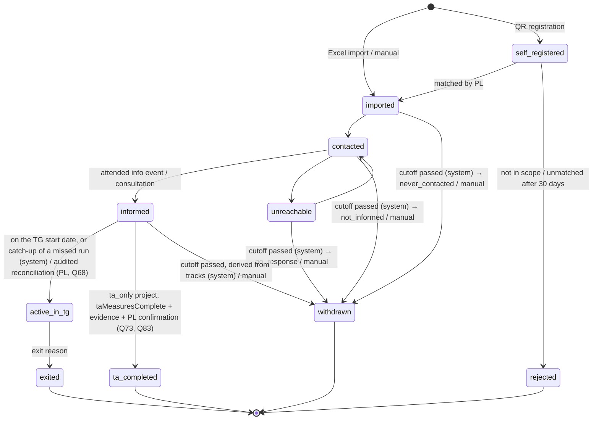
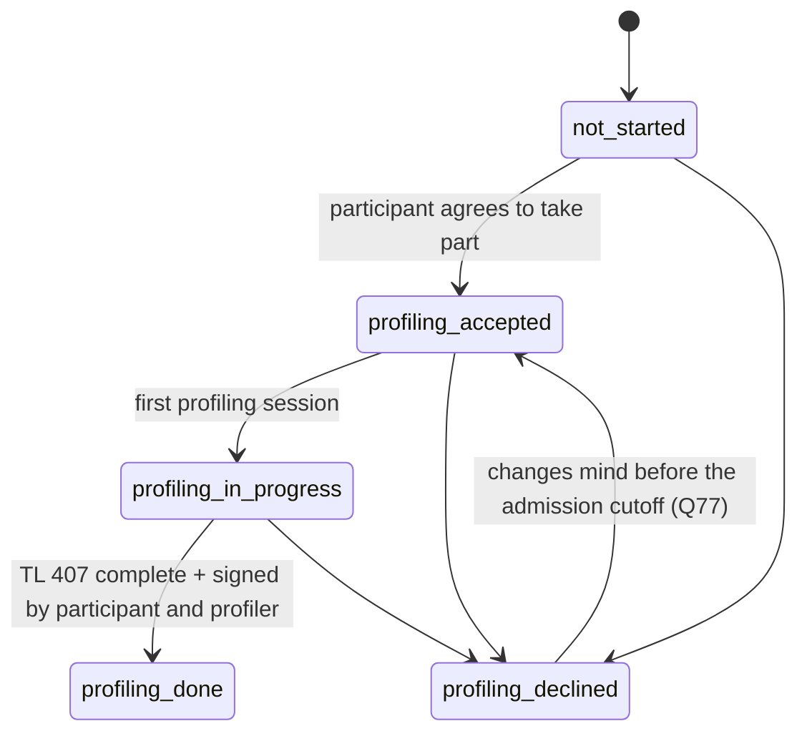
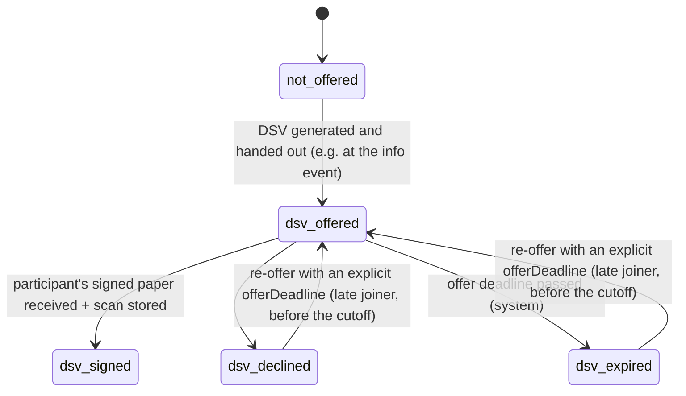

# Process & participant lifecycle

> Status: updated 2026-10-15 from the decisions log (`docs/decisions/`), including the
> two-track model from the PR #1 review (round 4), and 2026-10-16 from round 7 (deadlines from
> the contract, final admission cutoff, no overrides of documentary guards, employment vs.
> Transfer-KuG eligibility), and from round 8 (entry waves, catch-up of missed runs, approval of
> profiling exceptions, three Transfer-KuG outcomes, `taMeasuresComplete`) and round 9 (cutoff
> for participations without a wave, snapshot rule for TG entry) and round 10 (waves vs. beE
> units, profiling exception requests, end-reason corrections). Items marked *(provisional, Qnn)* rest on
> answers that are still `assumed` or `verify` in `open-questions.md`.

## Big picture

```
Customer (employer) ──► Transferprojekt (type: ta_only | ta_tg)
                          │
       ┌──────────────────┴───────────────────────────┐
  Phase 1: TA / pre-phase                         Phase 2: TG / beE (max. 12 months per person)
  contact → inform → in parallel:                 employment in the beE, Transfer-KuG,
     profiling track (TL 407)                     coaching, qualification, applications, exit
     DSV track (paper DSV, 3 signatures)
     Arbeitsuchendmeldung (Kug 200b)
```

- One **Person** has one **Participation** per project. In the MVP the same person is **not
  linked across projects** (Q30). Duplicate detection runs within a project only.
- A project is **`ta_only`** (§110 measures only, no beE, no DSV track) or **`ta_tg`** (TA phase
  + beE). *(provisional, Q20)*

## Two Agenturen *(provisional, Q15)*

| Role | Belongs to | Determined by | Responsible for |
|---|---|---|---|
| **Project Agentur** (`ta_tg`: the **KuG-Agentur**) | project | set at project setup (`ta_tg`: business location of the TG) | `ta_tg`: Anzeige über Arbeitsausfall, Transfer-KuG, final KuG settlement; `ta_only`: the §110 measure and its funding administration (Q90) |
| **Placement Agentur** | participation | participant's place of residence | Arbeitsuchendmeldung (Kug 200b), TL 407 submission, placement |

Participant steps resolve configuration from the placement Agentur's template, and project
steps from the Project Agentur's template (see regional-variation.md). Without a Project-Agentur
template a project of either type can't be activated (Q76, Q90).

## Dates

- Legal and calendar dates (signing deadline, TG start/end, exit date, ASU due date, settlement
  dates) are stored as `date`, not timestamps. Timestamps (`timestamptz`) are for events
  (audit, uploads).
- **TG start and end are per participation**, defaulting from the project (Q18). TL 407 needs
  both ("voraussichtliche Verweildauer in der beE von/bis").
- **ASU due date** *(verify, Q1)*: `asuDueDate = max(endDate − 3 months, knowledgeDate + 3 days)`,
  where `endDate` is the end of the old employment and `knowledgeDate` is when the person
  learned of it. To subtract months, clamp to the last day of the target month
  (31.05. → 28./29.02., 31.12. → 30.09.). The later date applies.
- **Signing and entry deadlines come from the Sozialplan / DSV / entry wave** (Q69), never from
  an Agentur template and never invented by the system.
- **Entry waves** (Q79): every `ta_tg` project has **one or more entry waves**, each with a
  name/code, `signingDeadline`, default TG start and end, and **`latestEntryDate`**. Each
  participation belongs to **exactly one wave before its DSV is offered**; individual
  contractual dates may override the wave defaults, with audit. An active `ta_tg` project needs
  at least one wave with a `latestEntryDate`, otherwise it stays draft (Q77). The project's final
  entry date (the latest wave cutoff) is derived, for project-level reporting only.
  A wave is a **timing cohort**, not a beE and not a Transfer-KuG bucket (round 10): one beE may
  hold several waves, or a later wave gets its own beE with its own term; a later `bee_unit` /
  Transfer-KuG case is a separate entity that waves reference. `ta_only` projects have no waves
  (their cohorts are measure groups).
  - `signingDeadline` (wave): the deadline of the first DSV offer. A **re-offer** needs an
    explicit participation-level **`offerDeadline`**, no later than the wave's `latestEntryDate`
    and the planned TG start. If no contractual rule is recorded, the PL enters the deadline.
  - **`latestEntryDate`** (wave): the last possible entry into the beE, inclusive. The **final
    admission cutoff** starts the following Berlin calendar day (Q77). It **replaces the former
    "signing deadline + 90 days" grace period**.
  - Deadlines are **inclusive**: expiry happens the following day.

## Project checklist (project-level BA steps) *(provisional, Q16, Q52)*

Not part of the participant lifecycle. Each item has a date, a document and a done-by:

- Consultation of the Betriebsparteien by the Agentur (before the Transfersozialplan)
- Anzeige über Arbeitsausfall to the KuG-Agentur
- `kugFinalSettlementDate` — final Transfer-KuG check by the Agentur (back office)
- `measure110SettlementDate` — settlement of the §110 grant, only if one exists (back office)

The settlement dates drive the evidence-set retention (data-protection.md). The admin dashboard
warns when a project ended more than 12 months ago without them.

## Lifecycle model: main status + two tracks + ASU record

In practice the DSV is handed out at the info event with a signing deadline, **in parallel
with profiling** (round 4). So a participation has:

| Part | Field | Values |
|---|---|---|
| **Main status** | `status` | `self_registered`, `imported`, `contacted`, `unreachable`, `informed`, `active_in_tg`; terminal: `withdrawn`, `rejected`, `ta_completed`, `exited` |
| **Profiling track** | `profilingStatus` | `not_started`, `profiling_accepted`, `profiling_in_progress`, `profiling_done`, `profiling_declined` |
| **DSV track** | `dsvStatus` | `not_offered`, `dsv_offered`, `dsv_signed`, `dsv_declined`, `dsv_expired` (only in `ta_tg` projects) |
| **ASU record** | `asu` | not a state machine: `submittedOn`, `channel`, optional `confirmedOn` |

- The tracks start when the main status reaches `informed`. Before that they stay at
  `not_started` / `not_offered`.
- Each track has its own transition function in `packages/domain`
  (`canTransition(track, from, to, context)`), and every change of any track goes through the
  same audited status function (see Rules). Every edge with its actors and guards, and the
  operations without a status change, are listed in the generated
  [lifecycle transitions table](generated/lifecycle-transitions.md).
- The UI may show **one derived overall status** (e.g. "DSV unterschrieben, Profiling offen"),
  computed from the main status and both tracks. It is never stored.

### Main status



**Manual withdrawal** (`→ withdrawn`, reason chosen by the PL) is allowed from `imported`,
`contacted`, `unreachable` and `informed`. If `dsvStatus = dsv_signed`, it additionally needs
the cancellation document (see DSV track). `self_registered` uses `rejected` instead.

### Profiling track



- `profiling_accepted` means the person agreed to take part. It is **not** GDPR consent: the
  legal basis is §110/§111 SGB III (Q4). The participant can still refuse, but then loses
  Transfer-KuG eligibility. The signature on TL 407 page 2 is a declaration on the form, not
  our consent record.
- Self-service data collection runs alongside: its completeness (per resolved config) is shown
  in "what's missing" and pre-fills TL 407. It is not a state.
- The TL 407 **submission to the Agentur** is tracked on the document (date, channel). It is a
  **"what's missing" item, not a TG entry guard** (Q54): §111(4) Nr. 4 requires taking part in
  profiling before the transfer, not submitting the form.
  - Not submitted by the TG start date → warning on the PL dashboard.
  - Still not submitted 14 days after TG start → escalation to the PL and the regional admin
    (the regional admin sees project, responsible PL, overdue count per type and days overdue
    for the oldest item; no participant names — Q57).
  - With the profiling exception, submission follows once profiling is caught up within the
    1-month deadline.
  - Also checked against the placement Agentur's `leadTimeDays`.
- **After TG entry with the profiling exception** *(verify, Q74)*: forward profiling
  transitions continue, and a later refusal (`→ profiling_declined`) can be recorded, because
  the system must not hide what happened. A refusal or a missed one-month deadline is an
  **immediate compliance escalation**; it doesn't end the employment automatically. See
  "Employment vs. Transfer-KuG eligibility".
- **Profiling exception requests** (`ta_tg` only; Q80, Q81, round 10): the PL requests one while
  `informed`, profiling still open and a future TG start applies, with a reason code and
  evidence. A different user (regional operations manager) approves or rejects it under the
  same conditions; only an approval counts, from its date. Each request is its own record: a
  rejected, revoked or superseded request is never reopened; a new request needs changed
  evidence and its own approval. A pending request is **superseded** automatically when
  profiling finishes, the participation closes or the project becomes `ta_only`; the PL
  **revokes** one that still applies. A passed start leaves it pending for a new start date,
  but it can never authorise entry for the missed date. All closures are audited.

### DSV track (only `ta_tg`)



- `dsv_signed` = the **participant** has signed. The DSV document also tracks
  `customerSignedOn` and `tgSignedOn`. **`dsvFullyExecuted`** is derived: all three dates are
  set (Q21).
- PLs get a list of DSVs **signed by the participant but not yet fully executed**, because this
  is where things typically get stuck.
- Original tracking per document: `originalLocation`, `receivedOn`, `sentToCustomerOn`.
- **Wave and offer deadline** (Q69, Q79): the DSV can only be offered once the participation
  is assigned to an entry wave. The first offer uses the wave's `signingDeadline`; a re-offer
  needs its own `offerDeadline` (≤ the wave's `latestEntryDate`, ≤ planned TG start). If neither
  exists, the offer can't be recorded until the PL enters one. `dsv_expired` happens the day
  after.
- **Withdrawal after `dsv_signed`** *(verify, Q46)*: before TG start, main status → `withdrawn`
  only with an uploaded cancellation document signed by all three parties. The PL confirms, and
  a customer notification flag is set. After TG start it is a normal TG exit.

### Arbeitsuchendmeldung (ASU)

Legally the registration counts, not the form: §38 SGB III allows registration online, in
person or by phone. Kug 200b is the usual channel in transfer projects, not the only valid one
(Q55).

- The ASU record stores `channel` (`kug_200b`, `online_self`, `in_person`), `registeredOn`, and
  **proof**: the submitted Kug 200b, a BA confirmation, or the BA-Kundennummer noted by the PL.
- **Registered** = a registration with proof, **regardless of channel**. This is what the TG
  entry guard checks.
- For `kug_200b`: `registeredOn` is the submission date to the Agentur, with the submission
  channel. Agentur confirmation (`confirmedOn`) is optional. No confirmation 14 days after
  submission → warning for the PL to follow up.
- If someone registered themselves, **still offer Kug 200b**, because it carries the consent
  that gives the TG access to the BA profile. This is a "what's missing" item, not a guard.
  Without it, the profile-access consent record simply stays empty.
- The **Kug 200b offer and its outcome are recorded separately** from the ASU proof (round 14):
  the participant may decline it, and a declined offer is an outcome, never a "missing signed
  scan". The RV-Nummer and the accepted signed scan are required only when ASU uses
  `kug_200b`; after `online_self` or `in_person` the ASU proof is enough for entry.
- An accepted ASU proof stands for the proof of **any valid channel**, including a structured PL
  attestation of the BA-Kundennummer; it never requires an uploaded file. A Kug 200b scan is
  accepted only when the review checked both declarations (fields 16 and 17) and the
  handwritten signature.
- The ASU completeness rules apply in `ta_tg` projects only (Q89); `ta_only` participants
  register themselves.
- `asuDueDate` (see Dates) drives reminders.

### TG entry guard (`informed → active_in_tg`)

A system job checks this **on** the participant's TG start date. Each condition must have
been met **on that date** (the facts carry dates):

| Condition | Override |
|---|---|
| `dsvFullyExecuted` (participant, customer and TG signatures) | **none** — no employment without the written contract (§623 BGB) |
| ASU registered **with proof**, any channel (Q55), required before transfer into the beE by §111(4) Nr. 4 SGB III | **none** — the profiling exception does not extend to the ASU |
| `profilingStatus = profiling_done` (TL 407 signed by participant and profiler) **or** an **approved** profiling exception (Q80) | the approved exception itself is the alternative |

TL 407 **submission** to the Agentur is not part of the guard (Q54).

If the guard fails, the participation stays `informed` and appears in the PL's "what's missing"
list. Guards marked "none" can't be overridden by anyone, and since round 7 (Q71) **no
documentary or contractual guard is overridable at all**.

**Entry after the planned date** (Q68, round 8) — three cases, never backdating on evidence
created later:
1. **The scheduled job didn't run**, but every prerequisite was valid for the TG start and
   already **recorded before that day's originally scheduled run time**: the next run **catches
   up automatically** with the `system` actor and the original TG start as effective date
   (audit detail `scheduled_entry_catchup`). This is reliability recovery, not late entry.
   - Automatic entry always uses a **snapshot as of the scheduled run** (facts store
     `recordedAt` timestamps). If the scheduled run **completed** and the guard failed, the
     start date is never reconsidered automatically, even if evidence arrives later that day
     (round 9).
2. **Evidence was recorded later** but proves that every requirement already existed on the TG
   start date: the PL performs an **audited reconciliation** (reviewed after the fact by
   regional operations management, Q80).
3. **A prerequisite actually arose after the planned start:** the PL records a new,
   contractually valid start date.

The application records the effective employment date; it doesn't create the employment
relationship.

**Profiling exception** *(Q17, Q60, Q74, Q80, Q81)*: if profiling wasn't possible before entry
into the beE, the **PL** requests an exception for a documented, justified case, with one of the
reason codes `participant_prevented_documented`, `agentur_scheduling_unavailable`,
`force_majeure`, `ba_confirmed_other` (the last with who at the BA confirmed it, and when). Every
code needs supporting evidence or a BA reference, stored separately (encrypted once available);
free text is special category (Q66). It can't be requested after `profiling_declined`.
- **Second-person approval before it counts:** a `regional_operations_manager`, who must be a
  different user from the requesting PL, approves it. Only an approved exception satisfies the
  TG entry guard. It is a planned compliance exception, not break-glass.
- It may be revoked before TG entry; after entry it is closed by completing profiling, never
  silently revoked.
- Profiling must reach `profiling_done` within **1 month of TG entry**; a refusal or a miss is
  an immediate compliance escalation and changes the Transfer-KuG outcome (below), but doesn't
  end the employment.

### Employment vs. Transfer-KuG eligibility *(verify, Q74, Q82)*

The domain keeps two things apart:
1. the participant's **employment in the beE/TG** (`active_in_tg` from the TG entry date to the
   exit date), and
2. **eligibility for Transfer-KuG** for a given period.

Each period has one of three outcomes: **`eligible`**, **`excluded`**, **`ba_review_required`**
(Q82):

| Situation | Outcome |
|---|---|
| profiling done before entry | `eligible` from the TG entry date |
| approved exception, profiling completed within 1 month | `excluded` from entry through the completion date; `eligible` from the day after (BA Fachliche Weisungen) |
| approved exception, profiling not yet completed, deadline running | `excluded` from entry, open |
| profiling refused before completion | `excluded` from the **TG entry date** (not the refusal date), open |
| one-month deadline missed | `ba_review_required` from entry; later completion doesn't clear it |

Only a recorded BA/legal determination may clear or alter an excluded period after a deadline
miss. Employment is never ended automatically by a refusal or a deadline miss. Affected periods
are blocked from any Transfer-KuG export. The application reports facts and decisions; it
doesn't issue a legal benefit determination. KuG billing itself is outside the MVP.

### System withdrawal at the final admission cutoff *(Q50, Q53, Q70; timing provisional, Q77)*

At the cutoff (the Berlin day after the wave's `latestEntryDate`), a nightly job with the
`system` actor moves participations to `withdrawn` when they can no longer reach the TG,
evaluated against **the participation's entry wave**. Without a `latestEntryDate`, the cases are
flagged and nothing moves or is deleted automatically (Q70, Q77).

**Participations without a wave** (Q84): the cutoff is the project's **final entry date** (the
latest `latestEntryDate` across all waves); on the next Berlin day `imported` → `never_contacted`,
`contacted` → `not_informed`, `unreachable` → `no_response`, with the same project-level warning
and reminder. Once a participation is assigned to a wave, that wave's cutoff applies. An
`informed` participation without a wave/DSV offer stays a flagged exception and is not withdrawn
automatically.

- **Warning** (Q78): from 14 calendar days before the cutoff, persistent until resolved, plus a
  final reminder 3 days before; a wave activated fewer than 14 days before is warned
  immediately. The warning is informational: at the cutoff the withdrawal runs.
- The withdrawal date `withdrawnOn` starts the non-signer deletion clock (Q77; period
  `assumed`).

| Precedence | Situation | Withdrawal reason |
|---|---|---|
| 1 | `dsvStatus = dsv_declined` | `declined_dsv` — the decision against the TG itself |
| 2 | `profilingStatus = profiling_declined` (and DSV not signed) | `declined_profiling` (no Transfer-KuG at all, reported separately) |
| 3 | `dsvStatus = dsv_expired`, or main status `unreachable` | `no_response` |
| — | main status `imported` | `never_contacted` |
| — | main status `contacted` | `not_informed` |

- Explicit decisions rank above silence (Q56). The highest-ranking reason is stored as the
  **primary reason**. All other applicable reasons are stored as a **secondary list**, so
  nothing is lost in the audit log.
- A reason chosen **manually by the PL** (e.g. `placed_direct`, `retirement`) always overrides
  the derived one. After a system withdrawal, the PL corrects the primary reason through a
  dedicated, audited **correction** that doesn't reopen the terminal status; the system-derived
  reason moves to the secondary list (Q72). An erroneous reason a PL chose earlier stays only in
  the audit history, unless the PL confirms it also applies; correcting to the same reason is
  refused (round 10).
- **Conflict:** `dsvStatus = dsv_signed` **and** `profilingStatus = profiling_declined`. The
  person can't enter the beE, but the DSV is signed. The system **does not resolve this
  automatically**. It flags the conflict to the PL for manual clarification.
- Participations in `informed` whose DSV was never offered (`not_offered`) at the cutoff are
  flagged to the PL, not withdrawn automatically.
- `declined_profiling`, `declined_dsv`, `no_response`, `never_contacted` and `not_informed`
  exist only as reasons, never as states.

### Rules

- Transitions are allowed **only along the arrows** (plus manual withdrawal). Implement them as
  pure functions in `packages/domain`, fully unit-tested, including the combination rules of
  the TG entry guard and the system withdrawal.
- **Every change of the main status or a track** is written in **one transaction** with its
  audit event, through a single status function. The app's DB role cannot `UPDATE` status
  columns directly (ADR-0002).
- Audit events record: actor (`user`, `participant` or `system`), `onBehalfOf` (assisted mode),
  timestamp, which field (`status`, `profilingStatus`, `dsvStatus`), from, to, reason.
- **Guards** depend on data and configuration. **Documentary and contractual guards are never
  overridable** (Q71): signed DSV scan and receiver, signed TL 407, fully executed DSV, ASU
  proof, cancellation after a signed DSV, TA completion evidence. The profiling exception is
  the only built-in alternative to a guard. A late admission after the cutoff needs a new
  approved deadline/start date or a contractual amendment, not an override.
- **Who may take which transition** (Q60): the PL all manual transitions of their project; the
  assigned consultant/profiler `contacted`/`unreachable`/`informed`, the profiling track and
  exits; back office DSV offered/signed/declined. Participants trigger no transition in the
  MVP: a portal declaration is evidence that authorised staff verify and record. The "Who"
  column of the [transitions table](generated/lifecycle-transitions.md) is generated from
  `mayPerformTransition` / `mayPerformOperation` (PR 1d-2).
- **Late joiners** come back along the explicit return arrows (`unreachable → contacted`,
  `profiling_declined → profiling_accepted`, `dsv_declined/dsv_expired → dsv_offered`) until
  the admission cutoff (Q77). Terminal states are final.
- **System transitions** (`dsv_expired`, `active_in_tg`, cutoff withdrawals) run in an
  idempotent nightly job with the `system` actor, using the `Clock` adapter.

### Exit and withdrawal reasons *(provisional, Q34)*

One enum with a `phase` attribute:

| Phase | Reasons |
|---|---|
| `pre_tg` (→ `withdrawn`) | `declined_profiling`, `declined_dsv`, `no_response`, `never_contacted`, `not_informed`, `placed_direct`, `self_employed`, `retirement`, `other_measure`, `deceased`, `other` |
| `tg` (→ `exited`) | `placed_permanent`, `placed_fixed_term`, `self_employed`, `retirement`, `apprenticeship_or_study`, `max_duration_reached`, `own_termination_without_job`, `terminated_by_tg`, `long_term_illness_reduced_earning_capacity`, `deceased`, `other` |

- `long_term_illness_reduced_earning_capacity` is **special-category** (health) data and never
  appears in ordinary lists; `deceased` is confidential (Q66).
- Placements also record: `contractType` (full/part time), `fixedTermMonths`, `tempAgency`,
  `backToFormerGroup` (reported separately), `startDate`, optional new employer.
- **Integration rate** = placements (`placed_direct`, `placed_permanent`, `placed_fixed_term`,
  `self_employed`) ÷ all exits. Which reasons count is configurable.

### TG sub-status periods *(provisional, Q33, Q51)*

While `active_in_tg`, a participation has **dated periods** (from, to): `active`, `sick_paid`
(first 6 weeks), `sick_krankengeld` (no KuG), `parental_leave`, `qualification`,
`temp_employment_elsewhere` (fixed-term job with a right to return).

- These are payroll records: type and dates only. Never diagnoses, never AU scans (eAU: we only
  store "AU confirmed: yes, dates").
- Visibility: back office sees the type. PL and profiler see only "abwesend" with dates.
- Transfer-KuG is limited to 12 months per person: remind the PL before `max_duration_reached`.

## Phase 1 detail

| Step | Who | Output |
|---|---|---|
| Project setup | PL | project type, Project Agentur (KuG-Agentur for `ta_tg`), dates (signing deadline, default TG start/end), regional templates |
| Import | PL | participations in `imported`; import report with row errors/duplicates |
| Registration QR | PL → participants | `self_registered` participations, matched manually by the PL |
| Info events & appointments | PL/Berater, participants self-book | attendance → `informed`; DSV often handed out here (`dsv_offered`) |
| Consents | participant | consent records per purpose (portal contact, Kug 200b profile access) |
| Self-service data collection | participant (or staff in assisted mode) | personal data, CV, documents |
| Arbeitsuchendmeldung | participant / TG | ASU record with channel and proof; Kug 200b signed, collected and submitted in batches per placement Agentur (also offered to self-registered people for the profile-access consent) |
| Profiling | profiler + participant | profiling track, TL 407 (incl. "Anlage" for overflow), signatures |
| Submission to Agentur | assigned PL | TL 407 submission status and channel per participant |
| DSV | PL / back office | DSV track, signatures of all three parties, scan, original location |

## Phase 2 detail (TG module)

| Area | Content |
|---|---|
| Participant file | phase 1 data + beE employment data |
| Coaching | appointments, structured notes, goals, agreed tasks |
| Qualification | activities: course, provider, cost, `fundingSource`, `approvalStatus` (customer budget owner approves in writing), certificate (Q23) |
| Applications | applications, interviews, trial work (Probearbeit), offers |
| Sub-status periods | see above; input for payroll/KuG export |
| Exit | reason, date, placement details → statistics |

§110 measures in `ta_only` projects (profiling, application training, career guidance, short
qualification) are activity records with date, duration and attendance (Q20).

## Roles (summary — access rules in data-protection.md)

Admin, Regional admin (region = Niederlassung), Regional operations manager (region-scoped
reviewer and approver without case access, Q80), PL, Berater/Profiler, Back office,
Participant. The customer is **not a user in the MVP**: it receives a monthly export from the
PL (Q47). Access is role × project, plus assignment for profilers. A person can hold **several
project roles** in one project and different roles in different projects; permissions are the
union, and sensitive access still needs the participant assignment *(assumed, Q61)*.
