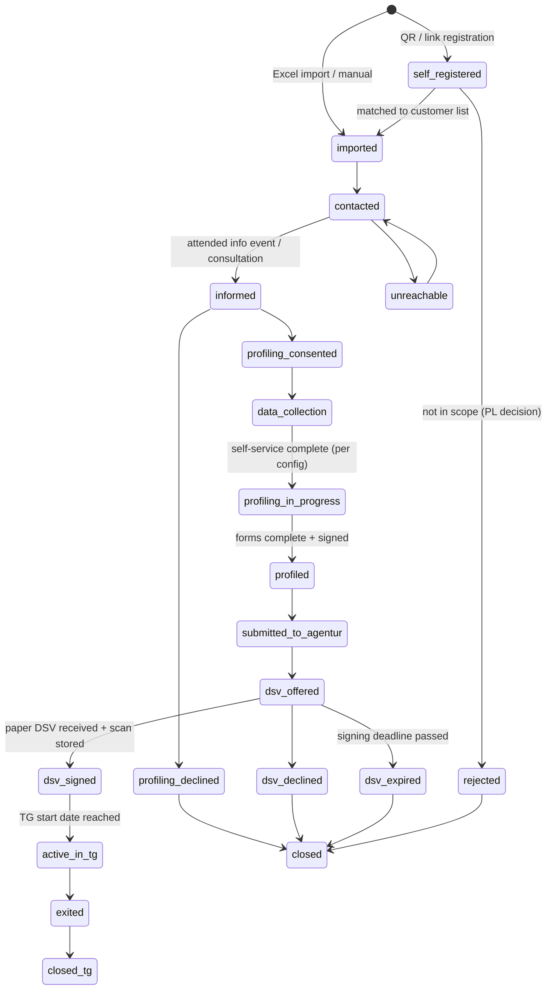

# Process & participant lifecycle

## Big picture

```
Customer (employer) ──► Transferprojekt
                          │
       ┌──────────────────┴───────────────────┐
  Phase 1: TA / pre-phase                Phase 2: TG (max. 12 months)
  inform → self-service data →           employment in TG, Transfer-KuG,
  profiling → BA forms → DSV             coaching, qualification, applications, exit
```

One **Person** can take part in one or more **Projects** (rare, but model it). The
relationship is a **Participation** (Person × Project). The participation carries the
lifecycle status. Modules (profiling, DSV, TG) attach to a participation.

A project can be **TA-only** (no TG phase) or **TA + TG**. Modules are switched on per project.

## Lifecycle state machine (Participation)



### Rules

- Transitions are only allowed along the arrows. Implement as a pure function in
  `packages/domain` (`canTransition(from, to, context)`), fully unit-tested.
- Some transitions have **guards** that depend on configuration, e.g.
  `data_collection → profiling_in_progress` requires all *required* fields/documents of the
  resolved project configuration (see regional-variation.md).
- Every transition writes an **audit event** (actor, timestamp, from, to, reason/comment).
- PL can **override** a guard with a mandatory reason (audited). No silent overrides.
- `closed` participations of non-signers trigger the **retention/deletion workflow**
  (see data-protection.md).
- `exited` requires an **exit reason**: `placed_employed`, `self_employed`, `end_of_term`,
  `early_termination`, `other` (+ optional new employer, start date).
- Late joiners: a PL can move a participation back into the flow before the TG start date;
  this is an explicit, audited action.

## Phase 1 detail

| Step | Who | Output |
|---|---|---|
| Project setup | PL | project, dates, signing deadline, modules on/off, applied regional template |
| Import | PL | participations in `imported`; import report with errors/duplicates |
| Registration link / QR | PL → participants | `self_registered` participations, matched to import |
| Info events & appointments | PL/Berater, participants self-book | attendance → `informed` |
| Consent | participant | consent records per purpose |
| Self-service data collection | participant (or Berater in assisted mode) | personal data, CV, documents |
| Profiling | Berater + participant | profiling record, generated forms, signatures |
| Submission to Agentur | PL/back office | submission status per participant |
| DSV | back office | generated DSV PDF, paper signature, scan upload, status |

## Phase 2 detail (TG module)

| Area | Content |
|---|---|
| Participant file | everything from phase 1 + TG employment data |
| Coaching | appointments, structured notes, goals, agreed tasks |
| Qualification plan | planned courses, provider, cost, approval status, budget usage |
| Applications | applications, interviews, trial work (Probearbeit), offers |
| Attendance / absences | input for KuG billing and payroll (export only in MVP) |
| Exit | reason, date, new employer → placement statistics |

## Roles (summary — details in prd.md)

PL, Berater, Back office, Participant, Customer/Works council (aggregated read-only), Admin.
Access is **role × project** (a PL sees only their projects; regional admins see their region).
