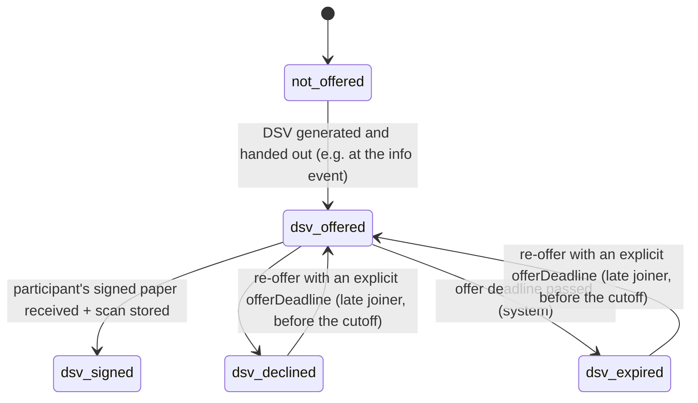

# Process & lifecycle: DSV

### DSV track (only `ta_tg`)

- `dsv_signed` = the **participant** has signed. The DSV document also tracks
  `customerSignedOn` and `tgSignedOn`. **`dsvFullyExecuted`** is derived: all three dates are
  set (Q21).
- PLs get a list of DSVs **signed by the participant but not yet fully executed**, because this
  is where things typically get stuck.
- Original tracking per document: `originalLocation`, `receivedOn`, `sentToCustomerOn`.
- **Wave and offer deadline** (Q69, Q79): the DSV can only be offered once the participation
  is assigned to an entry wave. The first offer uses the wave's `signingDeadline`; a re-offer
  needs its own `offerDeadline` (≥ today, ≤ the wave's `latestEntryDate`, ≤ planned TG start; see
  Guards). If neither
  exists, the offer can't be recorded until the PL enters one. `dsv_expired` happens the day
  after.
- **Generation as built** (Slice 7, PR 7-1; readings Q226): the DSV is our own template, pinned
  per project ("DSV-Vorlage", the PL; fixed from the project's first generation). The PL or back
  office generates it on the tab "DSV" for an open participation of an active `ta_tg` project in a
  wave with both effective TG dates while the track is `not_offered`, `dsv_declined` or
  `dsv_expired` (`dsv_offer_open` once offered: its paper is reopened, not regenerated). **The
  deadline is chosen before generation:** the wave's `signingDeadline` as the dialog showed it
  (first offer only) or an explicit date (a re-offer), with the guard's rule `offer_deadline_valid`
  (today ≤ deadline ≤ `latestEntryDate`, ≤ the effective TG start), and printed on the paper. The
  generation stores a **source token** over every printed value; it is **stale** once a printed
  value changes, its deadline passes, or (for the wave's deadline) the wave's deadline moves.
  `dsvGenerated` is the latest current generation (valid from its Berlin day, recorded at its
  instant). The paper is signed by hand; nothing in the app signs.
- **Withdrawal after `dsv_signed`** *(verify, Q46; Q213 accepted provisionally)*: on or before the
  effective TG start, main status → `withdrawn` only with an accepted cancellation scan signed by all
  three parties, dated not before it; the PL confirms, and "Kunde informieren" is raised until the PL
  records the notice (as built: "Cancellation, withdrawal, end reason and customer notice", below).
  From the day after the planned start a participation that never entered goes to the entry
  clarification (Q220); after an actual entry it is a TG exit (Slice 8).

### DSV offers as built (7-2a)

The PL or back office records the exact paper offered: a current generated DSV (its generation
id and printed deadline) or external paper's deadline and printed TG dates. External paper needs
no scan to record the offer; its terms must match the effective TG dates. Signature evidence is
recorded separately. Both actions compare the displayed status version under the participation
lock. An offer and its audited status change commit together; the database refuses an offered
status without the paper's offer record. Decline names the offer and status version; expiry and
signature transitions close that same offer. A generation preceding an ended offer cannot be
reused for a re-offer.

### DSV scans and participant signature as built (7-2b)

The PL or back office uploads a scan against the open offer, recording the actual dates visible
for any of the participant, customer and Transfergesellschaft signatures, the receiving staff
member and receipt date. Nothing is defaulted. Dates cannot be in the future (Berlin calendar);
receipt cannot precede the participant's signature. A foreign offer is not found; an offer that
has ended cannot receive a scan. The file follows the existing scanned, encrypted upload path.

Review is final: accept with explicitly confirmed signature dates, or reject as `unreadable`,
`wrong_document` or `incomplete`. External paper additionally requires confirmation that its
terms match the recorded offer (`terms_mismatch`). Confirmed dates are separate
`dsv_scan_signature` records; omitting a signature at review does not confirm the upload's date.
The acceptance audit records signature kinds and terms confirmation, never signature dates.

`dsv_facts` supplies `dsvScanReceived` only from accepted scans of the open or signed offer with
a confirmed participant signature and receipt. Deleted, quarantined and invalidated scans supply
no fact. `validOn` remains the actual participant signature date; `recordedAt` is the latest of
acceptance, signature recording and quarantine lift. Lifting quarantine never substitutes its
date for the signature date. Existing statuses are not reversed when evidence stops counting.

“Als unterschrieben erfassen” names the exact counting scan and the displayed status version.
The service checks evidence; `sign_dsv` checks it again under the participation lock, and
`apply_status_change` independently refuses `dsv_signed` without the open offer's counting
scan, including direct calls to the ordinary status function. There is no override.
An ended offer takes no accepted scan, but a scan of it may still be **rejected**: a rejection
creates no fact, so staff clear their queue without the PL deleting the file (changed in 7-3; the
open offer and the signed offer take acceptances, see below).

### DSV packet, TG entry check and original as built (7-3)

**The complete packet.** `dsvFullyExecuted` rests on one accepted, counting scan of the *signed*
offer whose confirmed signatures are the participant's, the customer's and the
Transfergesellschaft's: usually the countersigned original uploaded after "Als unterschrieben
erfassen" (the signed offer takes scans too), or the first scan when all three signed at once. Two
scans never add up. `validOn` is the latest of the three actual dates; `recordedAt` the scan's
acceptance, or its later quarantine lift (the dates stay the signatures'). The participant's date
must equal the offer's signed date: **a participant date that differs from another accepted scan
of the offer is refused** (`signature_date_mismatch`, at upload and at review, whichever scan
carries the wrong date; a scan with the identical date is accepted at review). Correcting a wrong
date is not a second scan (date corrections, a later PR). The guard also needs the DSV track
`dsv_signed` (Q97).

**The TG entry check in the database.** `apply_status_change` refuses `active_in_tg` with
`dsv_packet_missing` unless the DSV track is `dsv_signed` and a counting complete packet of the
signed offer was valid by the effective entry date and, for an automatic entry (`scheduled_entry`,
`scheduled_entry_catchup`), recorded before the run's snapshot (`scheduledAt`). The reconciliation
needs only the validity. A quarantined, invalidated or deleted packet supplies nothing; after a
lift the dates stay and the recording instant moves, so a scheduled run that completed without it
is never repeated and the late evidence qualifies for a reconciliation. No override exists (Q71),
whoever calls the status function. The DB `CHECK` that an entered participation has a signed DSV
track stays.

**The contract and the original.** `dsv_contract` (one per signed offer, `participation_record`;
the original's location goes with the personnel file) is created when the offer is signed and
holds the facts that survive the scans: the three actual signature dates, `fullyExecutedOn`, the
Berlin day each fact was accepted and the kind of role (`project_lead`, `back_office`; never a
person) that received and accepted. Each is set when first established and never rewritten by a
later quarantine or invalidation. PL and back office record the original's controlled location
(`paper_personnel_file`, Q110), the day it was received and the day it was sent to the customer
(`PUT .../dsv/contract/original`, one field, the value read as `expected`, `409 stale_value`;
dates not in the future); the audit event `dsv_original_recorded` names the field and the location
code only. It is tracking, not a guard (Q71).

**"Nachweis ungültig" for a DSV scan.** An approved invalidation of a DSV scan stays unresolved until a
counting scan of the same offer, accepted after the approval, shows every signature the invalidated
scan showed, with the same actual date.

### DSV work list, bulk generation, cutoff cases and the entry clarification as built (7-4)

**The work list item.** A `dsv_signed` participation that is `informed` and has no counting complete
packet has the case item "DSV nicht vollständig unterschrieben", dated by the participant's signature
day (`dsvSignedOn`: the contract's, else the counting scan's). The filter "DSV: unterschrieben, nicht
vollständig" (`caseItem=dsv_not_fully_executed`), the dashboard tile of the same name and the item
count the same participations: the filter and the tile are `matchesWorklistFilter` over the one
snapshot. Only the PL and back office see the DSV items, the tile and the bulk action (the packet is
the employment contract's, `mayWorkDsv`); anyone else gets no tile rather than a count of 0.

**Bulk generation.** The PL or back office generates the DSV for 1 to 100 selected participations of
one project with one deadline, all or nothing (`POST /projects/{id}/dsv/generations`). Every item is
checked as a single generation is; one refusal refuses the batch and names the item's position,
never an id. Then every paper is rendered and stored and all are recorded in one transaction in
participation id order under the project's exclusive lock (`record_form_generation` takes
`p_batch_size`; the audit event carries `batchSize`); a failure at the record or in storage removes
every stored paper. The deadline is chosen first: the wave's signing deadline only when every
selected row is a first offer of one wave, else a date entered.

**The cutoff cases.** The flag `dsv_signed_not_entered_at_cutoff` is raised for an `informed`
participation with a signed DSV from the day after the wave's latest entry date; it is informational
and the system never withdraws a signed DSV. It is not raised for the conflict with a declined
profiling (that flag stays) and gives no cutoff warning before the cutoff. It links to the tab "DSV"
where the entry clarification is worked on. The dashboard tile "Klärungsfälle Stichtag"
(`flag=cutoff_case`) counts the four flags the cutoff leaves to the PL.

**The entry clarification** (Q214, Q220 open). From the day after the effective planned TG start, a
signed DSV that is still `informed` is a case owned by the project's PL (the item "Eintritt klären");
it stays until the participation leaves `informed` and changes no status. There is one unresolved
case per participation, found by the participation and not by the current start date: when the
planned start moves on, an unresolved case stays on the tab, on the work list (dated by the day it
opened), in "Freigaben" and actionable. The tab
"DSV" offers the paths whose guards pass: the reconciliation when the complete packet, the ASU proof
and the profiling (or the approved exception) were valid on the planned start (its route follows in
7-6), and a new start date with its amendment while the wave's latest entry date allows one. The PL
documents what is pending (`awaiting_countersignature`, `awaiting_asu_proof`, `awaiting_profiling`,
`awaiting_legal_advice`) with a documented source line (`record_entry_clarification`; a second record
replaces the note until the case is escalated), then escalates the note they saw
(`escalate_entry_clarification`). The regional operations manager of the project's region either
records the instruction (`legal_advice_obtained`, `dpo_instruction`, `authority_or_court_decision`,
`parties_agreement`; once, never the PL who escalated; the case then stays open) or asks the PL again
(`request_entry_clarification_reply`, with `evidence_unclear`, `date_unclear` or `other_documented`
and a source line): the case returns to the PL, who replies by documenting again and escalates again.
Every step is kept (`entry_clarification_step`) and shown to the PL and the manager. Every write
compares the participation's status version and the clarification's own revision it read
(`stale_status_version`, `stale_clarification`, the first record included), under the lock. The audit
events `entry_clarification_recorded`, `_escalated`, `_requested` and `_instructed` are in the
history's `case` stream with the code only, never the source. Which legal outcomes exist for such a
contract is Q220: no edge exists for a cancellation or termination after the planned start, and
nothing is invented.

### Cancellation, withdrawal, end reason and customer notice as built (7-5)

*(Q46 verify, Q213 accepted provisionally, Q72; readings Q229; legal questions Q230.)*

**The cancellation.** A signed DSV is cancelled on paper by the participant, the customer and the
Transfergesellschaft; nothing in the app signs. The PL or back office uploads the cancellation's scan
(`dsv_cancellation`, catalog version 10) against the signed offer while the participation is
`informed` on it, with the dates on the paper per signature, the receiver and the day received,
nothing defaulted (the DSV scan's rules: no date in the future, received not before the
participant's date). The review accepts it only with all three signatures confirmed with their dates
(`cancellation_signatures_missing`), or rejects it as `unreadable`, `wrong_document` or
`incomplete`; quarantine, its lift and the PL's deletion before review are the DSV scan's.
`dsvCancellation` is the earliest recorded counting cancellation: valid on its latest actual
signature, recorded at its acceptance or a later lift (a lift never moves the date). A quarantined,
invalidated or deleted cancellation supplies nothing.

**The withdrawal.** `POST /participations/{id}/withdrawal` (the PL, "Zurückziehen") moves
`imported`, `contacted`, `unreachable` or `informed` to `withdrawn` with a `pre_tg` reason (a
special-category reason is refused), the effective date (no default, not in the future) and the
status version read. For a signed DSV the status service additionally needs the counting cancellation
valid today and the PL's confirmation (the guard), the effective date not before the cancellation's
validity and today on or before the effective TG start (`withdrawalProblem`); `apply_status_change`
checks the documentary parts again under the lock (`dsv_cancellation_missing`,
`effective_date_before_cancellation`, `after_planned_start`, `tg_start_missing`, and
`withdrawal_after_dsv_signed` for any actor but a user), whoever calls the status function, and holds
the cancellation's row until the commit. No override (Q71). From the day after the planned start the
withdrawal is refused and the entry clarification is open (D12, Q220).

**The end reason.** `PUT /participations/{id}/end-reason` (the PL, "Grund korrigieren") corrects the
primary end reason after a withdrawal or exit as Q72 says (`correct_end_reason`), against the reason
the PL read (`409 stale_value`), without reopening the status.

**The customer notice** (Q46's flag). A participation withdrawn on its signed DSV has the work list's
item "Kunde informieren", dated by the withdrawal, until the PL records "Kunde informiert am"
(`POST .../dsv/customer-notice`, `record_customer_notice`): once (`notice_recorded`), not in the
future, not before the withdrawal day (`notice_before_withdrawal`). It is the one DSV item a terminal
participation keeps; the PL and back office see it, only the PL records it. The audit event
`dsv_customer_notified` (history stream `dsv`) carries the day. The customer whitelist (CLAUDE.md
rule 6) is unchanged.

**The cutoff flags.** `conflict_dsv_signed_profiling_declined` links to the tab "DSV": the flag is
raised from the cutoff, when the return arrow of profiling (`before_cutoff`) is closed, so the paths
left are the cancellation while the planned start allows it, else the entry clarification;
`dsv_never_offered` and `informed_without_wave_at_cutoff` keep the dates card, and "Zurückziehen" is
in the page header's actions on every tab; `dsv_signed_not_entered_at_cutoff` links to the entry
clarification as built in 7-4.
