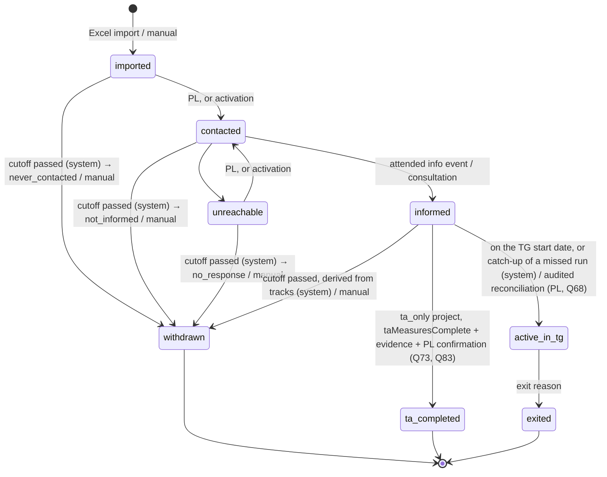

# Process & lifecycle: main status and rules

## Lifecycle model: main status + two tracks + ASU record

In practice the DSV is handed out at the info event with a signing deadline, **in parallel
with profiling** (round 4). So a participation has:

| Part | Field | Values |
|---|---|---|
| **Main status** | `status` | `imported`, `contacted`, `unreachable`, `informed`, `active_in_tg`; terminal: `withdrawn`, `ta_completed`, `exited` |
| **Profiling track** | `profilingStatus` | `not_started`, `profiling_accepted`, `profiling_in_progress`, `profiling_done`, `profiling_declined` |
| **DSV track** | `dsvStatus` | `not_offered`, `dsv_offered`, `dsv_signed`, `dsv_declined`, `dsv_expired` (only in `ta_tg` projects) |
| **ASU record** | `asu` | not a state machine: the route (`asuChannel`) and a registration with its channel, `registeredOn`, proof and the instant of the complete fact; optional `confirmedOn` (Slice 6, PR 6-5a) |

- The tracks start when the main status reaches `informed`. Before that they stay at
  `not_started` / `not_offered`. **Track activity** (domain and database function): the tracks
  move only while the main status is `informed`, the DSV track only in `ta_tg`; while
  `active_in_tg` with an approved profiling exception, only forward profiling moves and a
  refusal (`→ profiling_declined`); otherwise, and after any terminal status, a track change is
  refused (`track_inactive`).
- Each track has its own transition function in `packages/domain`
  (`canTransition(track, from, to, context)`), and every change of any track goes through the
  same audited status function (see Rules). Every edge with its actors and guards, and the
  operations without a status change, are listed in the generated
  [lifecycle transitions table](../generated/lifecycle-transitions.md).
- The UI may show **one derived overall status** (e.g. "DSV unterschrieben, Profiling offen"),
  computed from the main status and both tracks. It is never stored.
- **Lifecycle flags are derived, never stored** (`lifecycleFlags`, `projectFlags` in the
  planner; vocabulary `LifecycleFlag` / `ProjectFlag` in `packages/domain/src/lifecycle/enums.ts`).
  They inform or escalate, never change a status: `tg_start_missed` (`informed`, effective TG
  start passed), `cutoff_warning`, `cutoff_final_reminder`, the cutoff cases for the PL
  (`conflict_dsv_signed_profiling_declined`, `dsv_never_offered`,
  `informed_without_wave_at_cutoff`), and the compliance flags, only while `active_in_tg`:
  `profiling_declined_after_entry`, `profiling_exception_deadline_missed`. Project flag:
  `latest_entry_date_missing` (a `ta_tg` project without waves or with a wave lacking one).

### Main status

**Manual withdrawal** (`→ withdrawn`, reason chosen by the PL) is allowed from `imported`,
`contacted`, `unreachable` and `informed`. If `dsvStatus = dsv_signed`, it additionally needs
the cancellation document, on or before the effective TG start (see DSV track; as built in PR 7-5).

**Activation-code issuance (as built in Slice 3, PR 3d):** the project's PL or back office may
issue a letter, event sheet or in-person code while the project is active and the participation is
non-terminal. Before `informed`, issuance is refused after the participation's cutoff. Letters need
the imported postal address and birth date. Event sheets are not usable until an audited handover
after a photo-ID check; in-person codes record the same check before being sent. Reissue is explicit
and revokes the open code atomically. This step does not change lifecycle status.

**Account activation** (Q116, Q121, [round 36](../../decisions/2026-10-20-answers-round-36.md),
as built in Slice 3 PR 3e): a participant's first activation moves `imported` or `unreachable` to
`contacted` in the same transaction, along the edges of kind `activation` (actor `participant`, the
only edges a participant takes, each with `before_cutoff`). Before `informed` it needs the
participation's cutoff not to have passed: checked when the code is accepted and again with
database time at completion (`before_cutoff`). In `contacted`, `informed` or `active_in_tg` it
changes no status. Only `complete_activation` takes these edges: it calls the internal
`apply_status_change`, which holds the status body; the granted `change_participation_status`
keeps its signature and refuses a participant actor (`actor_not_allowed`). An activated account
gets no new activation code (`already_activated`; a recovery code comes with PR 3f).

A terminal status runs in the status transaction: moving to `withdrawn`, `ta_completed` or
`exited` revokes every open activation code as `participation_closed`, ends the participant's
sessions (`participation_closed`) and cancels the live bookings of appointments that haven't
started (`participation_closed`, audited by the system; see "Appointments").

There is no self-registration: `self_registered` and `rejected` (its only path) left the
lifecycle core in Slice 3 ([round 35](../../decisions/2026-10-20-answers-round-35.md)).

### Rules

- Transitions are allowed **only along the arrows** (plus manual withdrawal). Implement them as
  pure functions in `packages/domain`, fully unit-tested, including the combination rules of
  the TG entry guard and the system withdrawal.
- **Every change of the main status or a track** is written in **one transaction** with its
  audit event, through a single status function. The app's DB role cannot `UPDATE` status
  columns directly (ADR-0002).
- Audit events record: actor (`user`, `participant` or `system`), `onBehalfOf` (assisted mode),
  timestamp, which field (`status`, `profilingStatus`, `dsvStatus`), from, to, reason.
- **Effective dates**: a change records a business date exactly when it leads to `active_in_tg`,
  `exited`, `withdrawn`, `profiling_done` or `dsv_expired`; any other transition with a date is
  refused (`effective_date_not_allowed`), one of these without it `effective_date_required`. The
  status service validates the date after the lock; the database function requires it too.
  Derived dates must match exactly (`effective_date_mismatch`): TG entry its effective TG start
  (the caller may omit it), `dsv_expired` the offer deadline + 1, a system cutoff withdrawal the
  applicable `latestEntryDate` + 1. Staff dates (manual withdrawal, exit, `profiling_done`) may
  be backdated. No date lies in the future (`effective_date_in_future`); an exit never precedes
  the entry (`effective_date_before_entry`).
- **Fail-safe rule**: where the docs don't decide a case, the code takes the safe side: access is
  denied (`undecided`, naming the open question), an automatic transition doesn't run, and an
  operational exception is flagged to the PL rather than resolved (e.g. Q85, Q86).
- **Guards** (defined below) depend on data and configuration. **Documentary and contractual guards are never
  overridable** (Q71): signed DSV scan and receiver, signed TL 407, fully executed DSV, ASU
  proof, cancellation after a signed DSV, TA completion evidence. The profiling exception is
  the only built-in alternative to a guard. A late admission after the cutoff needs a new
  approved deadline/start date or a contractual amendment, not an override.
- **Who may take which transition** (Q60): the PL all manual transitions of their project; the
  assigned consultant/profiler `contacted`/`unreachable`/`informed`, the profiling track and
  exits; back office DSV offered/signed/declined. Participants trigger no transition in the
  MVP: a portal declaration is evidence that authorised staff verify and record. The "Who"
  column of the [transitions table](../generated/lifecycle-transitions.md) is generated from
  `mayPerformTransition` / `mayPerformOperation`.
- **Late joiners** come back along the explicit return arrows (`unreachable → contacted`,
  `profiling_declined → profiling_accepted`, `dsv_declined/dsv_expired → dsv_offered`) until
  the admission cutoff (Q77). Terminal states are final.
- **System transitions** (`dsv_expired`, `active_in_tg`, cutoff withdrawals) run in an
  idempotent nightly job with the `system` actor, using the `Clock` adapter.

### Guards

The pass conditions of the guards in the [transitions table](../generated/lifecycle-transitions.md)
(`canTransition`; none overridable, Q71). A dated fact counts only from its `validOn`; an absent
fact is false. "By the TG start" means valid on the effective TG start (own, else the wave's);
for a `system` entry the fact must also be recorded before the scheduled run (snapshot rule).

| Guard | Passes when |
|---|---|
| `dsv_fully_executed` | DSV track `dsv_signed` **and** `dsvFullyExecuted` by the TG start (Q97) |
| `asu_registered_with_proof` | ASU registration with proof by the TG start |
| `profiling_done_or_approved_exception` | `profilingDone` or an approved profiling exception by the TG start |
| `tg_start_date` | an effective TG start exists; `scheduled_entry`: today is the TG start; `scheduled_entry_catchup`: the TG start has passed; `reconciliation`: today is after the TG start, or on it once that day's run completed |
| `ta_completion` | `taMeasuresComplete` valid today and the PL's confirmation |
| `withdrawal_after_dsv_signed` | DSV not `dsv_signed`; else a cancellation signed by all three parties valid today, the PL's confirmation and a `user` actor (the system never withdraws a signed DSV). Beside the guard, `withdrawalProblem`: the effective date not before the cancellation's validity (`effective_date_before_cancellation`) and today on or before the effective TG start (`after_planned_start`) |
| `before_cutoff` | no wave, or a wave without `latestEntryDate`, or today ≤ `latestEntryDate` |
| `entry_wave_assigned` | the participation has a wave |
| `offer_deadline_valid` | the deadline (an explicit `offerDeadline`; for a first offer, else the wave's `signingDeadline`) exists, today ≤ deadline ≤ `latestEntryDate` and ≤ the effective TG start; fails without a `latestEntryDate` or an effective TG start |
| `tl407_signed`, `dsv_generated`, `dsv_scan_received` | the fact is valid today |

### Exit and withdrawal reasons *(provisional, Q34)*

One enum with a `phase` attribute:

| Phase | Reasons |
|---|---|
| `pre_tg` (→ `withdrawn`) | `declined_profiling`, `declined_dsv`, `no_response`, `never_contacted`, `not_informed`, `placed_direct`, `self_employed`, `retirement`, `other_measure`, `deceased`, `other` |
| `tg` (→ `exited`) | `placed_permanent`, `placed_fixed_term`, `self_employed`, `retirement`, `apprenticeship_or_study`, `max_duration_reached`, `own_termination_without_job`, `terminated_by_tg`, `long_term_illness_reduced_earning_capacity`, `deceased`, `other` |

- `long_term_illness_reduced_earning_capacity` is **special-category** (health) data and never
  appears in ordinary lists; `deceased` is confidential (Q66).
- Placements also record: `contractType` (full/part time), `fixedTermMonths`, `tempAgency`,
  `backToFormerGroup` (reported separately), `startDate`, optional new employer.
- **Integration rate** = placements (`placed_direct`, `placed_permanent`, `placed_fixed_term`,
  `self_employed`) ÷ all exits. Which reasons count is configurable.

### Manual contact statuses as built (7-9)

*(Q60 assumed, Q215 accepted; Q233 accepted, with its amendment.)*

"Kontaktstatus" in the page header (the PL, the assigned consultant/profiler) moves the main status
along the existing `manual` edges only: `imported → contacted`, `contacted → unreachable`,
`unreachable → contacted` (its `before_cutoff` guard; `imported → contacted` has none). The route
`POST /participations/{id}/contact-status` calls the status function, which writes the
`status_changed` event in the same transaction (ADR-0002); no new audit event type. The dialog
captures the status version when it opens and offers only the targets the capability allows,
nothing preset; a change meanwhile is `409 stale_status`. A step the viewer may take but which is
closed now (the admission cutoff, the project not active) is shown in the dialog with its reason and
no save (Q233); a step the viewer may not take is not shown. No contact note or channel is recorded. `contacted → informed` stays the
attendance's path (information delivery), and `informed`, `active_in_tg` and the terminal statuses
have no contact step.
