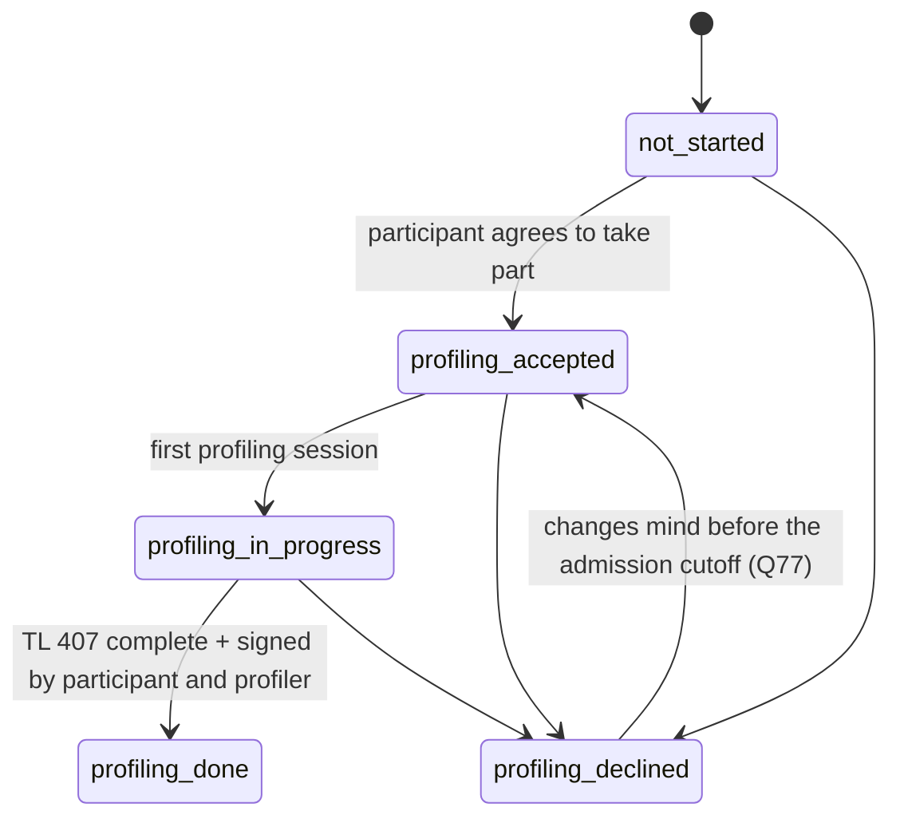

# Process & lifecycle: profiling

### Profiling track

- `profiling_accepted` means the person agreed to take part. It is **not** GDPR consent: the
  legal basis is §110/§111 SGB III (Q4). The participant can still refuse, but then loses
  Transfer-KuG eligibility. The signature on TL 407 page 2 is a declaration on the form, not
  our consent record.
- Self-service data collection runs alongside: its completeness is derived per participation
  from its own resolved chain (the base TL 407 rules of the `profiling` step plus its placement
  Agentur's and the override's, `regional-variation.md`, "Self-service wizard"), shown as codes in
  "what's missing", and pre-fills TL 407. It is not a state: there is no "submitted"; each page is
  saved on "Weiter" and the participant may leave one incomplete.
- The TL 407 **submission to the Agentur** is a **"what's missing" item, not a TG entry guard**
  (Q54): §111(4) Nr. 4 requires taking part in profiling before the transfer, not submitting the
  form. *(accepted, Q188, Q189; as built in Slice 6, PR 6-5b; readings Q206)*
  - **"An Agentur übermittelt am"** (the PL, `submit_tl407`): an accepted signed TL 407 that is
    live, neither quarantined nor invalidated, sent to the participation's placement Agentur by
    its resolved `submissionChannel`, on the actual sent date (not in the future, not before the
    later signature, not before the last rejection), while the participation is open. Refused
    without a placement Agentur, with the `agentur_submission` blocker (all four settings, Q92),
    while a submission stands, and for a version expired in the registry only where the
    Agentur's resolved `rejectsOutdatedFormVersions` is `true` (Q188). The PL submits the
    destination (the placement Agentur) and the settings shown; another Agentur since, even with
    identical settings, or changed settings is `409 source_changed`. Every attempt is its own `agentur_submission`
    row, which keeps whether the Agentur needed the original when it was sent.
  - **"Original versandt am"**, once, where the Agentur needs the paper original apart from the
    submission (`originalRequired`, not `paper_original`): until then the item
    `tl407_original_missing`. After a rejection and a new submission of the same paper to the same
    Agentur, the PL may instead confirm **"Original liegt der Agentur vor"** (Q206 (4)): the new
    attempt links the earlier dispatch and keeps its actual date. It is never assumed: the item
    stays until the PL confirms it or records a new dispatch.
  - **"Von der Agentur abgelehnt"** (`outdated_form_version`, `incomplete`, `other`, with its
    date), once per attempt: it reopens the work (`tl407_resubmission_open`) until a new
    submission, and never invalidates the signatures, the scan or the completed profiling. A
    version rejection asks the form owners to check the registry version (ADR-0009). A batch's
    Kug 200b has no rejection or retransmission yet (Q204).
  - **Deadline `tl407_submission`** ("TL 407 einreichen", in `ta_tg`, while `informed` or
    `active_in_tg` and no submission stands): the effective TG start minus the placement
    Agentur's `leadTimeDays` (the TG start while it is unresolved); under an approved exception
    the day profiling was done (none before: the exception's own deadline applies), so the
    submission follows promptly after the catch-up.
  - **Escalation:** still not submitted from TG start + `tl407EscalationDaysAfterTgStart` (14) →
    the item `tl407_escalated` for the PL and the type `tl407_not_submitted` in the regional
    admin's view, whatever the exception: no baseline moves, so a late catch-up escalates at once
    when that day has passed. A rejection counts as not submitted, so a rejection after that day
    re-escalates at once. The escalation is dated by its **current episode** (Q206 (8)): from TG
    start + 14, or from a later rejection that reopened it, so its age never counts the time a
    submission stood ("seit heute" for a rejection received today).
  - **Compliance escalation at once:** a refusal after entry (`profiling_declined_after_entry`)
    or a missed one-month deadline under an exception (`profiling_exception_deadline_missed`, the
    day after the deadline) is the type `profiling_compliance` the day it happens, with no grace
    period.
  - **The regional view** (`GET /escalations`, "Eskalationen"; Q57): per `ta_tg` project of the
    regional admin's regions (the admin: every project) its active PLs and, per type, the number
    of escalated participations and the days since the oldest escalated (0 on its day). No
    participant; details come from the PL (data-protection.md, the regional view).
- **Agentur items** (`agenturItems`, the work list's column "Agentur", the filter "Agentur", the
  tile "Agentur offen" and the group "Agentur"), in urgency order: `tl407_escalated` (from its
  day), `tl407_resubmission_open` (the rejection's date), `tl407_original_missing` (the
  submission's date) and `kug200b_confirmation_missing` (a batch's registration without the
  Agentur's confirmation from `kug200bConfirmationFollowUpDays` (14) after it, with its sent
  date; Q203 (9)). A terminal participation keeps the original and the confirmation (what was
  sent), never the submission work. Each count is the number of distinct participations its
  filter matches in the same snapshot.
- **After TG entry with the profiling exception** *(verify, Q74)*: forward profiling
  transitions continue, and a later refusal (`→ profiling_declined`) can be recorded, because
  the system must not hide what happened. A refusal or a missed one-month deadline is an
  **immediate compliance escalation**; it doesn't end the employment automatically. See
  "Employment vs. Transfer-KuG eligibility".
- **Profiling exception requests** (`ta_tg` only; Q80, Q81, round 10): the PL requests one while
  `informed`, profiling still open and a future TG start applies, with a reason code and
  evidence. A different user (regional operations manager) approves or rejects it under the
  same conditions; only an approval counts, from its date. Each request is its own record
  (round 16): a rejected, revoked or superseded request is never reopened or overwritten; its
  reason and evidence (one immutable evidence record, by id and canonical fingerprint) never
  change. A new request needs changed evidence (a different fingerprint, not just another
  record) and its own approval. A pending request is **superseded** automatically when
  profiling finishes, the participation closes or the project becomes `ta_only`; the PL
  **revokes** one that still applies. A passed start leaves it pending for a new start date,
  but it can never authorise entry for the missed date. All closures are audited.
- **Profiling exceptions with evidence** *(as built in Slice 6, PR 6-7; D30, Q194; readings
  Q208)*: on the tab "Profiling" the block "Ausnahme vom Profiling" shows the current request
  (status, reason, dates, the evidence's kind) and the evidence documents by upload instant and
  review state only. The PL (and the assigned consultant) uploads `profiling_exception_evidence`
  there ("Nachweis hochladen"); the PL never opens it (data-protection.md, exception evidence),
  the assigned consultant reviews it on "Unterlagen", and a file's presence is no verification.
  The PL's safety actions sit on the same list ("Unter Quarantäne stellen", "Quarantäne
  aufheben", "Löschen" before the review, each with a reason chosen in a dialog), authorised
  without any read right (the review of PR #102).
  "Ausnahme beantragen" (the PL, while `informed`, profiling open, no open request): a reason code
  and the evidence, each chosen explicitly (no default): **reviewed documents** (the accepted,
  usable ones the PL ticks) or the **Agentur's confirmation** (the Agentur from the
  participation's choices, the confirming contact or reference, the confirmation date, not in
  the future). The app first records the immutable **evidence record**
  (`POST /participations/{id}/exception-evidence`; an Agentur outside the choices is refused
  server-side, `agentur_unknown`), then the request on it
  (`POST /participations/{id}/profiling-exception-requests`); `ba_confirmed_other` needs a BA
  confirmation (`ba_confirmation_missing`). The request function reads the record under the
  participation lock: another participation's record or one whose documents no longer count
  (quarantined, invalidated, deleted) is `evidence_missing`; the record's fingerprint equal to the
  latest request's is `evidence_unchanged`, so identical bytes under a new id, another order or an
  equal confirmation re-entered never count as changed evidence. **"Freigaben"** (`/reviews`, the
  regional operations manager of the project's region) lists the pending requests of `informed`
  participations: project, reason code, the request date, the TG start, the evidence's kind and
  "Nachweis vorhanden" (or that it no longer counts); no name, no case data, no evidence content.
  "Genehmigen" and "Ablehnen" are confirmed in a dialog and send the evidence record shown
  (`409 source_changed` if the request rests on another); never on one's own request (four eyes,
  403); an approval needs the evidence still usable (`evidence_missing`), a rejection doesn't. The
  decision takes the project's exclusive lock first (ADR-0002, D31). "Widerrufen" (the PL, before
  entry) captures the request and the status shown when its dialog opens and sends them
  (`409 source_changed` if it was decided meanwhile, `request_not_current` if another request
  replaced it; never adopted silently); after entry the exception is closed by completing
  profiling, and the compliance escalation applies. **An approval counts only while its evidence
  does** (the review of PR #102): while a document of its record is quarantined, invalidated or
  deleted, the fact `profilingExceptionApproved` is withheld from every later evaluation; after a
  quarantine's lift it is valid and recorded no earlier than the lift. The request, its decision,
  the history and past snapshots stay as they were. A request from before evidence records rests on
  a `legacy_unverified` record (the upgrade, ADR-0002), which never counts. The
  exception's events keep round 17's details; recording evidence is audited
  `exception_evidence_recorded` (its id and kind; for documents how many) in the `profiling`
  history.

### The profiling record *(accepted, Q192, Q193; as built in Slice 6, PR 6-2; readings Q198)*

The staff app's tab "Profiling" (data-protection.md, the profiling record, for who sees what):
- **Track actions** (`POST /participations/{id}/profiling-status`, Q60): the PL and the assigned
  consultant take one step along an edge of the
  [transitions table](../generated/lifecycle-transitions.md) with the participation's
  `statusVersion` (`409 stale_status`), through the status service and the status function, so
  every step is audited `status_changed` and checked by `canTransition` with track activity as
  built (also forward and a refusal while `active_in_tg` under an approved exception, Q74). The
  buttons: "Teilnahme zugestimmt", "Profiling begonnen", "Abgelehnt" (after a confirmation that
  names the loss of Transfer-KuG), "Erneut zugestimmt" (before the cutoff, Q77); each step comes
  with its refusal (`forbidden`, `project_not_active`, `track_inactive`, the guard).
  "Profiling abschließen" (`profiling_done`, Slice 6, PR 6-3b) needs `tl407_signed` and
  `profilingDoneOn` (Q191): an accepted signed TL 407 that is neither quarantined nor invalidated
  (data-protection.md, signed scans); `profilingDoneOn` is by default its later actual signature
  date, never before it (`effective_date_before_signature`) and never in the future; the recording
  instant stays apart. The status function holds that scan `FOR SHARE` until the commit. Back
  office takes no profiling step.
- **The TL 407 facts** (`dbGuardFacts`, the database instant of each complete fact; the snapshot
  rule under "TG entry guard"): `tl407Signed` is valid on the earliest later signature date of the
  usable scans (accepted, not quarantined, not invalidated) and recorded at that scan's acceptance
  (after a quarantine, at its lift); `profilingDone` exists only while a usable scan signed by
  `profilingDoneOn` supports that date (Q200): valid on `profilingDoneOn`, recorded at the later of
  the status change and the earliest supporting scan. Without one (the supporting paper was
  quarantined and only later-signed paper remains) the fact is withheld: the status and its date
  stay as recorded for a controlled resolution, are never moved automatically, and the tab says the
  completion isn't supported. A TL 407 accepted after the TG start's
  scheduled run therefore supports only a reconciliation, never the scheduled entry or its catch-up;
  a quarantined scan supplies no fact to a later evaluation, and no status is reversed by it.
  `asuRegisteredWithProof` (Slice 6, PR 6-4a; `asuRegisteredSince`) is valid on the actual
  registration date and recorded at the later of the registration, the link of its accepted proof
  and a lifted quarantine of the proving document: a proof accepted yesterday and linked today is
  recorded today. Without a proof, or with a quarantined or invalidated proving document, there is
  none. A request's evidence (PR 6-7) is its record of this participation while usable: valid on
  the BA's confirmation date or, for documents, the day the record was made, recorded at the
  record's creation. The DSV facts stay fail closed until Slice 7, so nobody enters the TG on real
  facts yet; the seed overlays its synthetic facts and records real BA confirmations for its
  exception requests.
- **Sessions** (Q193): date and `von`/`bis` (`hh:mm`), written whole by the assigned consultant
  with the record's revision (`409 stale_revision`): `bis` after `von` (equal refused), no date
  after today in Berlin, no two of one day overlapping (touching ends are fine), at most 50. Each
  session added, changed or removed is audited `profiling_session_changed` (its id and date). The
  PL reads them. Recording a session doesn't move the track, and a booked consultation is never a
  session by itself. They are evidence-set data (`participation_record`, Q88).
- **The pending declarations to the BA** (ba-forms.md, declarations): the Jobbörse choice and the
  BA contact declaration on the record, `null` while undecided, written by the assigned consultant
  with the same revision, audited `profiling_declarations_recorded` with the changed keys.
- **Section C, p. 7 and the unemployment period**: the profiler's, encrypted and each field
  audited (data-protection.md, the profiling record); the health line keeps its rating only.
  Gesamteinschätzung and weiteres Vorgehen keep their paragraph breaks into the TL 407; the line
  texts are single-line. The assessment and the unemployment period each have their own revision
  (`409 stale_revision`, also when clearing the period). A period whose "seit" is after its "bis"
  is stored with a warning shown when saving, not refused (a plausibility check, not a BA rule).
- **Concurrent editing** (ADR-0010, the profiling record): the tab reads each section's values
  with the revision they belong to; a save keeps its own returned revision with what it saved.
  The sessions and the declarations share the record's revision: saving one keeps the other's
  unsaved input and moves its revision on while its stored value is unchanged; if another tab
  changed that value meanwhile, the section says so and keeps the input until "Neu laden", and a
  save from the stale input is refused (`409`), never applied.
- **The highest school qualification** (Q196): the participant marks one education row in the
  wizard, the profiler confirms or corrects it with them in assisted mode; the TL 407 lists it
  first (ba-forms.md, row order). Never inferred. Before TL 407 generation (Slice 6, the TL 407),
  an explicit reviewed "no school qualification" answer is valid and "not yet clarified" is
  incomplete; no row is fabricated, and a review holds only for the source values it reviewed.
- A terminal participation takes no profiling writes (`participation_closed`); the tab shows it
  read-only and says why. Corrections after the end go through the controlled correction route,
  not ordinary editing.
